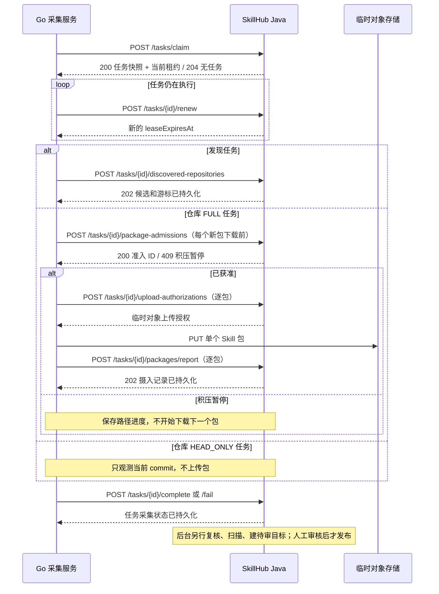

# GitHub 同步内部接口说明

> **用途：当前 Java–Go 内部协议说明。** Java 已实现按类型 `claim`、`renew`、系统凭证临时下发与当前租约的额度/认证失效/限流回报、发现候选批次接收与结算、候选及已登记来源的仓库任务调度、仓库 `HEAD_ONLY` / `FULL` 结算、分类 `fail` 与受控诊断码、逐包准入、上传授权、摄入回报、后台归档校验，以及已校验包到同步 Skill 版本和独立审核任务的持久交接；Go 已实现常驻双工作池、发现执行器、选择性包获取和仓库任务处理器，并接入可选的 Compose、Helm 与 K8s 部署入口。规则预览不创建来源或待审项；具体集成验收入口和边界见 [验证说明](../../openspec/changes/add-github-skill-sync/verification.md)。`fail` 可在有效租约内同时回报系统凭证额度与受控诊断码；不持久原始异常文本。接口目标合同以同目录的 [OpenAPI YAML](github-sync-internal.openapi.yaml) 为准；产品行为、来源归属和审核规则以 [OpenSpec change](../../openspec/changes/add-github-skill-sync/README.md) 为准。本文解释流程，不另建一套协议。

## 1. 调用边界

- **调用方向：** Go 主动请求 Java。Java 保存配置、持久任务、租约、路径结果、包摄入与审核状态；Go 不连接 Java 数据库或 Redis，也不调用普通用户发布接口。
- **基础路径：** `/internal/github-sync/v1`，只供内部网络访问，不暴露为面向浏览器的公开 API，也不加入 Web SDK。
- **认证：** 所有接口使用独立服务身份 `Authorization: Bearer <service-secret>`。浏览器会话、普通用户/API Token、GitHub Token 均不能代替服务身份。本地流式上传还须提供 `X-Upload-Ticket`。
- **当前 Java 配置：** `SKILLHUB_GITHUB_SYNC_SERVICE_TOKENS` 接受逗号分隔的新旧服务密钥，每枚至少 32 个字符；不配置时内部接口拒绝所有请求。`SKILLHUB_GITHUB_SYNC_LEASE_DURATION` 初值为 `PT5M`，需在小范围联调中校准。
- **上传授权：** `SKILLHUB_GITHUB_SYNC_UPLOAD_TICKET_TTL` 默认 `PT5M`，最长一小时；S3/MinIO 的暂存 PUT 优先以 `SKILLHUB_STORAGE_S3_ENDPOINT` 签名，公开 GET 继续使用 `SKILLHUB_STORAGE_S3_PUBLIC_ENDPOINT`，本地存储使用 Java 同源相对路径与独立上传票据。Go 的 S3 目标主机须由部署方显式允许。回报前 Java 检查对象存在及实际大小；SHA-256 和包内容由后续摄入工作流再验证。
- **暂存清理：** `SKILLHUB_GITHUB_SYNC_SIGNED_UPLOAD_CLEANUP_GRACE` 默认 `PT1H`，`SKILLHUB_GITHUB_SYNC_UPLOAD_CLEANUP_INTERVAL_MS` 默认 `300000`。未被摄入接受且已失效的上传，以及已完成版本复制、无变化或校验终止失败的对象可以清理；S3 票据须先经过宽限期，删除失败保留领取状态供后续重试。仍在校验、等待版本绑定或因冲突阻断的对象不会按固定 TTL 清理。
- **包上限变化：** Java 在逐包回报时先核对已持久接收的幂等结果，再按当前包上限复核尚未接受的票据与实际对象大小。票据签发后上限调低或 S3/MinIO 实际对象超限时，回报 `TOO_LARGE`；仅在票据从未接收状态成功转为失败后尝试删除对象，避免并发回报删除已接收包。删除失败由暂存清理任务补偿，本地已上传对象也可立即进入补偿清理。
- **后台校验：** `SKILLHUB_GITHUB_SYNC_INGESTION_VALIDATION_LEASE` 默认 `PT30M`，`SKILLHUB_GITHUB_SYNC_INGESTION_VALIDATION_INTERVAL_MS` 默认 `5000`。Java 从 `RECEIVED` 领取单包，复核归档大小、SHA-256、ZIP 符号链接及条目边界，并复用现有 Skill 包校验器；通过后标记 `VALIDATED`，仍未创建版本或审核目标。失败留错误码，未接受或确定失败的对象由清理任务按状态处理。
- **后台发布交接：** `SKILLHUB_GITHUB_SYNC_PUBLICATION_LEASE` 默认 `PT4H`，`SKILLHUB_GITHUB_SYNC_PUBLICATION_INTERVAL_MS` 默认 `5000`。Java 独立领取 `VALIDATED` 包，锁定摄入记录并重新核对归档与内容指纹；同内容转 `NO_CHANGE`，新内容在同一数据库事务中创建 Skill 版本、来源路径绑定与 `GITHUB_SYNC` 审核任务，再转 `READY_FOR_REVIEW`。审核批准、拒绝或被更新目标取代后，摄入状态结算；待审前不会公开发布。归档按受限临时目录处理，真实容量与对象存储行为仍须联调。
- **许可证证据：** Go 从固定 commit 的 Tree 元数据挑选仓库根目录的 LICENSE、LICENCE、COPYING、NOTICE、COPYRIGHT 及常见后缀文件，最多 16 个；单文件最多 64 KiB、预览内容合计最多 256 KiB。超过预览限制的文件仍记录 Git blob 摘要与大小，不下载全文。Go 在 ZIP 中使用 `__skillhub_sync_evidence__.json` 清单及 `__skillhub_sync_evidence__/` 文件区传递证据；Java 重新校验大小和已携带文件的 Git blob 摘要，把仓库根证据纳入正式内容指纹并单独保存证据快照。这些内部条目不进入 Skill 安装包。缺失或无法预览的许可证信息保留为审核警告；当前不自动判定 SPDX 许可证，也不自动批准。
- **仓库观测周期：** `SKILLHUB_GITHUB_SYNC_REPOSITORY_CHECK_INTERVAL` 初值为 `PT24H`，只在后台尚未保存仓库目标周期时作为兼容回退。平台管理员通过 `/api/v1/admin/github-sync/schedule-policy` 配置仓库更新、精选用户或组织及广泛搜索的类别目标周期；`HEAD_ONLY` 和完整仓库任务完成后，Java 按当前后台值设置来源下次检查时间。
- **候选忽略：** 已登记来源的仓库任务快照携带 `ignorePatterns`，Go 在固定 commit 的树上只过滤候选 Skill 根，不删除父包内的普通文件。Java 对当前来源规则复核：新包准入返回 `PATH_IGNORED`，已接收包在摄入或发布前转为忽略终态。规则变化后旧任务不能推进来源的完整处理检查点；已发布内容不自动撤回。
- **调度周期：** `SKILLHUB_GITHUB_SYNC_DISCOVERY_SCHEDULER_INTERVAL_MS`、`SKILLHUB_GITHUB_SYNC_CANDIDATE_SCHEDULER_INTERVAL_MS`、`SKILLHUB_GITHUB_SYNC_SOURCE_SCHEDULER_INTERVAL_MS` 初值均为 `60000`。已登记来源的排队批次按 namespace 轮流选取到期来源，仓库任务领取优先已登记来源，并参考各 namespace 最近成功领取时间，避免单一 namespace 持续占用领取名额；候选来源仍按精选用户优先于搜索候选。Java 只在配置了水位且低于恢复边界时启动新候选树检查；已登记来源在反压期间按到期计划改做 `HEAD_ONLY`。仓库完整处理检查点要等待完整任务及其相关包校验结束，不随单次包回报提前推进。
- **仓库改名与转移：** Go 在仓库元数据请求中仅跟随 `https://api.github.com` 内的有限次数跳转，取得响应后先核对稳定的 repository ID，再通过当前任务租约调用 `repository-metadata`。Java 再核对 ID 并更新来源或候选坐标与任务快照；后续 HEAD、树和包获取使用 GitHub 返回的新坐标，市场链接优先使用来源的当前坐标。跨主机跳转不会携带系统凭证继续请求。旧名称被别的仓库占用时，ID 不匹配会阻断处理；旧地址的跳转失效后，当前方案不能仅凭旧坐标自动找回新地址，需由后续发现命中同一 ID 或管理员处理。跳转处理依据 [GitHub REST API 最佳实践](https://docs.github.com/en/rest/using-the-rest-api/best-practices-for-using-the-rest-api#follow-redirects)；GitHub 也说明[转移后的旧地址可能被复用而失去跳转](https://docs.github.com/en/repositories/creating-and-managing-repositories/transferring-a-repository)。
- **历史清理：** `SKILLHUB_GITHUB_SYNC_COMPLETED_DETAIL_RETENTION` 默认 `P90D`，`SKILLHUB_GITHUB_SYNC_HISTORY_CLEANUP_INTERVAL_MS` 默认 `3600000`。调度器每轮限量清理已完成且无恢复引用的发现任务及空运行；候选入口归属独立保存，不因任务清理而丢失精选优先级或来源归属。已完成的仓库任务在包摄入均已结算且不再承担候选恢复后缩减快照和检查点；被更新结果取代的逐路径明细删除，来源仍需展示的最新路径状态保留。仓库任务/运行 ID 继续支撑已发布版本和审核追溯，过期运行不再出现在后台运行列表。未完成任务、待审或冲突项及其恢复数据不按期限清理；容器日志由部署环境管理。
- **逐包续跑：** 仓库任务领取响应的 `acceptedPaths` 来自同一任务、固定 commit 下已被 Java 持久接收的包；即使检查点尚未提交，Go 也跳过这些路径。`retryPaths` 标识需要重试的失败路径，即使位于检查点之前仍要处理。两者均由 Java 的逐路径持久状态计算，不由 Go 本地文件推断。两个独立 Go HTTP 客户端进程验证已接收包不重复上传；实际仓库 worker 再用受控 GitHub Tree 跨进程验证失败路径重访、Java 持久 `retryAt`、到期重领和终态结算。两条链路均在本地和 MinIO 模式通过；GitHub Tree 网络请求仍由受控 fixture 代替。
- **请求关联：** 每次调用均带独立 `X-Request-Id`；它只用于日志关联，不能充当幂等键。Go 到 Java 的 HTTP 客户端应与 GitHub 出站代理客户端分开。
- **协议版本：** 路径主版本为 `v1`，`claim` 请求还传 `protocolMajor: 1`。不兼容主版本返回 `426 PROTOCOL_UNSUPPORTED`；兼容的可选字段增加不得改变已有状态含义。
- **敏感数据：** `claim` 响应中的可选公开读取 GitHub Token、租约令牌、上传 URL/票据只在执行时使用，不能进入持久任务、日志、异常、指标标签或仓库 URL。服务身份与 GitHub 凭证是两种独立密钥。

以下示例中的 ID、SHA、路径和占位符只用于说明格式，不代表现有环境数据或可直接调用的服务。

## 2. 一次任务的调用顺序



`claim` 和 `renew` 建立当前租约代际。Go 的发现池与仓库池分别用 `kind` 领取；只在租约有效时进行上传授权、批次回报、逐包回报和任务结算，过期后须停止，等待 Java 重派。发现任务和仓库任务共用接口，但 `discovery`、`repository` 与 `mode` 由任务类型决定。仓库第一次领取时 `fixedCommitSha` 可为空，由 Go 固定本轮 commit；续跑时 Java 下发原固定 commit、`pathCheckpoint`、`incompleteSubtrees`、`retryPaths` 和 `acceptedPaths`。

发现批次须携带 `previousCheckpoint` 与新的 `checkpoint`。首批的前置值为 `null`；Java 在有效租约内原子保存候选、任务命中和新游标，相同批次重放不重复计数。任务快照中的 `candidateBudget` 限制当前租约新增线索数；Java 另以管理策略中的 `candidatePendingLimit` 限制该 namespace 中排队或正在验证的候选总数。前置游标已过期、同游标内容冲突或超出任一预算时拒绝整批，不能把搜索命中直接视为正式来源。重领任务时，`discovery.checkpoint` 由 Java 已持久游标覆盖原始快照；待验证候选未被消费前不会无限扩张。

发现任务调用 `complete` 时必须引用最后一批已确认的 `discoveryCheckpoint`。覆盖完整返回 `ACQUISITION_COMPLETE`；尚有未查页面或需延期的窗口时使用 `INCOMPLETE` 和未来的 `retryAt`，任务进入 `RETRY_WAIT`。这只结算搜索采集，不代表候选仓库已验证或 Skill 已发布。

`SEARCH_PREVIEW` 是发现池的独立任务快照。Go 对各结构化条件最多查询 GitHub 搜索第一页，经 `POST /tasks/{taskId}/preview-results` 回传每条件总量估计、不完整/千条上限信号与最多五个公开仓库样例；Java 在有效租约内原子写入任务快照并结算。预览不调用发现候选批次接口，不创建候选、来源、包或待审 Skill。Java→Go→Java 的两条件完成与第二条件限流场景已用受控搜索页联调：限流时只保存未来重试时间，不留下部分预览结果。各条件可能命中同一仓库，命中数不能直接相加；元数据搜索也可能漏召回。

`CURATED_REPOSITORY` 任务携带固定的 `owner` 与 `repositoryName`。Go 通过公开 GitHub API 解析 repository ID，最多回报一个仓库；Java 将首次解析的 ID 固定到精选入口，并直接登记平台来源。后续任务若解析为另一个 ID，Java 拒绝该批次。此类明确配置的来源不等待 Skill 候选验证；积压水位仍控制后续包准入。

`SEARCH_RULE` 的 `discovery.criteria.selectors` 是固定规则版本：每项为 `KEYWORD` 或 `TOPIC`，并标记 `CORE` 或 `EXTENSION`；`searchWindow` 固定本轮增量或全量重查时间范围。`KEYWORD` 仅搜索仓库名称、描述和 topics，`TOPIC` 限定 topic；每项单独查询并按 repository ID 合并。Go 不接受原始 GitHub 查询语法，不搜索 README 或代码；分页、GitHub 每查询最多 1,000 条的上限和 `incomplete_results` 必须纳入检查点与不完整结果处理。[GitHub 仓库搜索语法](https://docs.github.com/en/search-github/searching-on-github/searching-for-repositories)、[REST 搜索限制](https://docs.github.com/en/rest/search/search)。

高水位期间，发现任务仍可在 GitHub 额度与 `candidateBudget` 内回报去重的仓库线索和游标；Java 暂不把这些线索转换为已验证来源或安排新候选仓库树检查。预算满时保存游标并延后。已登记仓库只执行 `HEAD_ONLY`；Go 不领取新的 `FULL` 任务，已领取的 `FULL` 任务在下一个包前须重新申请准入。低水位恢复后，Java 重新核对候选仓库与来源的当前上游状态，再安排包采集。

## 3. 接口一览

以下路径均相对于 `/internal/github-sync/v1`。所有请求都要服务身份和 `X-Request-Id`；`{taskId}`、`{uploadId}` 在 YAML 中定义为 UUID。

| 方法与路径 | Go 提交 | Java 的成功确认 | 主要边界 |
| --- | --- | --- | --- |
| `POST /tasks/claim` | `workerId`、`protocolMajor`、`kind` | `200 ClaimedTask`；无任务 `204` | Java 按发现/仓库类型原子领取，返回任务快照、租约和可选临时 GitHub 凭证。 |
| `POST /tasks/{taskId}/renew` | `lease`（代际、令牌） | `200 leaseExpiresAt` | 仅当前代际可续租；旧租约 `409`。 |
| `POST /tasks/{taskId}/preview-results` | 当前 `lease`、各条件命中估计与样例 | `200 ACQUISITION_COMPLETE` | 只允许预览任务，不写发现候选。 |
| `POST /tasks/{taskId}/credential-status` | 当前租约、凭证 ID、`OBSERVED`、`AUTH_INVALID` 或 `RATE_LIMITED`；`OBSERVED` 必须带额度，`RATE_LIMITED` 必须带 `retryAt` | `204` | 只有该租约领取时绑定的凭证可更新；认证失效和限流分别处理，旧 Token 不能误伤已替换的新 Token。 |
| `POST /tasks/{taskId}/discovered-repositories` | 当前租约、公开仓库候选批次、续跑 `checkpoint`、延后统计 | `202`，批次与游标已持久化 | 仅发现任务使用；搜索命中不是正式来源，更不是已发布 Skill。 |
| `POST /tasks/{taskId}/package-admissions` | 当前租约、固定 commit、Skill 路径 | `200 admissionId`；高水位 `409 BACKPRESSURE_ACTIVE` | 仅仓库 `FULL` 任务使用；Go 在获取文件内容前申请，Java 原子预留容量。 |
| `POST /tasks/{taskId}/upload-authorizations` | 当前租约、`admissionId`、固定 commit、Skill 路径、包大小与 SHA-256 | `200 UploadAuthorization` | 仅仓库 `FULL` 任务使用；授权绑定已准入包和临时对象。 |
| `PUT /uploads/{uploadId}/content` | 二进制包、上传票据 | `204`，本地临时对象已写入 | 仅 `LOCAL_STREAM` 模式使用；接收时执行大小硬上限。 |
| `POST /tasks/{taskId}/packages/report` | 当前租约、`admissionId`、固定 commit、Skill 路径、上传 ID、包大小与 SHA-256 | `202 ingestionId`、`RECEIVED` | Java 已持久接收摄入记录；准入占位转为未解决摄入项，不表示内容校验、审核或发布成功。 |
| `POST /tasks/{taskId}/complete` | 租约、覆盖情况、逐路径结果、观测 commit、可选额度/重试时间 | `200`，Java 权威任务状态 | `COMPLETE`、`INCOMPLETE`、`HEAD_ONLY` 的检查点推进规则不同。 |
| `POST /tasks/{taskId}/fail` | 租约、分类原因、可选 `retryAt`、额度与受控诊断码 | `200`，失败/重试状态已持久化 | 仅接受 `WORKER_TIMEOUT`、`WORKER_ERROR` 或 OpenAPI 所列的 GitHub HTTP 诊断码，不保存原始异常文本。 |

### 领取任务示例

Go 发送：

```json
{
  "workerId": "github-sync-worker-1",
  "protocolMajor": 1,
  "kind": "REPOSITORY_SYNC"
}
```

Java 对仓库 `FULL` 任务的响应示意（省略可选的 `credential`）：

```json
{
  "taskId": "11111111-1111-4111-8111-111111111111",
  "runId": "22222222-2222-4222-8222-222222222222",
  "kind": "REPOSITORY_SYNC",
  "mode": "FULL",
  "namespaceId": 33,
  "sourceId": 44,
  "lease": { "generation": 2, "token": "<lease-token>" },
  "leaseExpiresAt": "2026-09-28T12:15:00Z",
  "repository": { "repositoryId": 123456, "owner": "example", "name": "skills" },
  "maxPackageBytes": 104857600,
  "maxSingleFileBytes": 10485760,
  "maxFilesPerPackage": 100,
  "maxUploadBytes": 104857600
}
```

发现任务的 `discovery` 快照示意：

```json
{
  "entryType": "SEARCH_RULE",
  "ruleVersion": 3,
  "criteria": {
    "selectors": [
      { "kind": "KEYWORD", "value": "agent skills", "priority": "CORE" },
      { "kind": "TOPIC", "value": "agent-skills", "priority": "EXTENSION" }
    ]
  },
  "searchWindow": {
    "mode": "INCREMENTAL",
    "since": "2026-09-27T00:00:00Z",
    "until": "2026-09-28T00:00:00Z"
  },
  "candidateBudget": 100
}
```

若响应为 `204`，Go 按运行配置退避后再轮询；不能把空队列记为同步成功。示例展示当前发布策略的默认值，部署的有效配置可改变下发上限。

### 逐包上传与回报

包下载前的准入请求示意：

```json
{
  "lease": { "generation": 2, "token": "<lease-token>" },
  "commitSha": "aaaaaaaaaaaaaaaaaaaaaaaaaaaaaaaaaaaaaaaa",
  "skillPath": "skills/example"
}
```

Java 准入后返回 `{"admissionId":"66666666-6666-4666-8666-666666666666"}`；该 ID 仅随当前租约、commit 和路径有效。若返回 `409 BACKPRESSURE_ACTIVE`，Go 不获取该包的文件内容。

1. Go 从固定 commit 的树元数据枚举到一个 `SKILL.md` 根目录，完成路径及大小预检后，先调用 `package-admissions`。Java 原子检查全局与 namespace 积压及未完成准入占位，返回绑定当前任务、commit 和路径的 `admissionId`；高水位返回 `409 BACKPRESSURE_ACTIVE`。Go 在准入被拒时不下载文件，保存路径进度并结算部分任务。已获准且正在处理的包可以完成；租约失效后不得继续下载。
2. 准入成功后，Go 只把所需文件下载到受限本地临时目录。按当前有效发布政策预检，当前 `application.yml` 配置为最多 100 个文件、单文件 10 MiB、包总量 100 MiB；逐包打包并计算**上传对象**的 SHA-256 与字节数。此摘要用于传输完整性；正式 Skill 内容指纹由 Java 解包后按规范化文件计算。
3. Go 携带 `admissionId` 调用 `upload-authorizations`，取得 `uploadId`、`mode`、`uploadUrl`、到期时间和必要标头。S3/MinIO 模式使用短时预签名 PUT；本地模式调用受服务身份与上传票据保护的 Java 流式 PUT。Go 仅向部署配置允许的存储主机上传，不跟随重定向。
4. PUT 成功后，Go 携带 `admissionId` 调用 `packages/report`，只交 `uploadId` 与完整性信息，不提供任意下载 URL。Java 在短事务中记录任务、commit、规范化路径、对象引用和摘要，返回同一 `ingestionId`，并将准入占位转换为未解决摄入项。Java 用自己的存储适配器由 `uploadId` 定位临时对象，再核对实际对象、解包规则、许可证、正式内容哈希、安全扫描和审核目标。未使用的准入在任务结算或租约失效后释放。
5. Go 可以继续处理同仓库其他包，但每个包都要重新申请准入。单包失败记录在路径结果中，不能让其他包失去已完成进度。

取得文件之前，Go 先通过固定 commit 的 GitHub Tree 元数据找到候选 `SKILL.md`，按子树处理截断响应，并依据 blob 大小和类型做预检。`blob:none` 仍可能在本地保存整个仓库的树元数据，稀疏检出会按需获取所选文件；因此工作目录预算要包含 `.git`、检出文件和归档，不能只算最终 Skill 包。逐包回报 `202` 后清理可释放的本地文件；接近预算时用 `pathCheckpoint`、`deferralReason: LOCAL_DISK_BUDGET` 和 `retryAt` 回报阶段结果，清理本批目录，从同一固定 commit 续跑。不完整范围不触发上游删除判断。[GitHub Tree API](https://docs.github.com/en/rest/git/trees)和[Git partial clone 文档](https://git-scm.com/docs/partial-clone)分别说明了树响应截断与延迟获取对象的边界。

`LOCAL_DISK_BUDGET` 延后只适用于清理工作目录后仍能处理下一批的情形。若当前容量连固定 commit 元数据或一个合规包都无法处理，Go 以 `coverage: INCOMPLETE`、`deferralReason: CAPACITY` 回报容量阻塞，Java 等待容量或规则调整后的管理员重试；不能给同一条件下的任务设置极短 `retryAt` 形成领取循环。预检须包含文件落地、归档及安全余量，且工作区应有部署可验证的独立容量边界；Kubernetes 临时存储限制可能通过驱逐 Pod 生效，不能视作对每次写入的精确拦截。[Kubernetes 临时存储资源说明](https://kubernetes.io/docs/concepts/configuration/manage-resources-containers/)。

逐包回报请求示意：

```json
{
  "lease": { "generation": 2, "token": "<lease-token>" },
  "admissionId": "66666666-6666-4666-8666-666666666666",
  "commitSha": "aaaaaaaaaaaaaaaaaaaaaaaaaaaaaaaaaaaaaaaa",
  "skillPath": "skills/example",
  "uploadId": "55555555-5555-4555-8555-555555555555",
  "sizeBytes": 4096,
  "sha256": "bbbbbbbbbbbbbbbbbbbbbbbbbbbbbbbbbbbbbbbbbbbbbbbbbbbbbbbbbbbbbbbb"
}
```

S3/MinIO 预签名 PUT 的 `maxBytes` 是 Go 应遵守、Java 随后复核的边界，不能仅凭 PUT 签名宣称对象存储接收时已强制最大字节数。临时对象须存放在隔离区域并有容量告警、超额清理；本地流式入口须在接收时执行硬限制。已被 Java 接收但尚未处理的对象不能只按固定 TTL 删除；失败对象需有清理与重采集记录。

### 暂存容量监控

Java 每隔 `skillhub.github-sync.upload-cleanup-interval-ms` 采样一次暂存账面预留量与本地磁盘容量。`skillhub.github.sync.staging.reserved.bytes` 汇总尚未清理的上传票据所声明的字节数；它不能反映绕过客户端限制的超额 PUT。使用本地存储时，`skillhub.github.sync.staging.local.available.bytes` 是存储目录所在文件系统的可用字节数；低于一个允许的最大 Skill 包大小或读取失败时，`skillhub.github.sync.staging.local.capacity.warning` 为 `1`，并输出警告日志。

S3/MinIO 模式下，Java 默认每小时以最多 100 次列举请求、10,000 个对象的上限扫描 `github-sync/staging/` 前缀。完整扫描时，`skillhub.github.sync.staging.s3.used.bytes` 与 `.s3.objects` 记录实际字节数和对象数，`.s3.scan.complete` 为 `1`；扫描不完整或读取失败时，实际字节数为 `-1`，`.s3.capacity.warning` 为 `1`，防止把截断结果误判为有余量。部署方须在启用 S3 同步前配置 `SKILLHUB_GITHUB_SYNC_STAGING_CAPACITY_LIMIT_BYTES` 为该暂存前缀可使用的正数字节预算；达到预算或未配置预算且暂存区已有对象时也告警。没有同步对象时不会仅因预算未配置而告警。`SKILLHUB_GITHUB_SYNC_STAGING_CAPACITY_SAMPLE_INTERVAL_MS` 可调整采样周期，默认 `3600000`。这项预算只约束告警判断，不代表对象存储服务的真实剩余空间或上传硬配额；仍需按存储服务的总容量/配额监控其余对象。指标是否通过 Actuator 暴露取决于部署的端点配置。

### 完成与失败

`complete` 的 `coverage` 明确三种情况：

| 值 | 允许的效果 |
| --- | --- |
| `COMPLETE` | 固定 commit 的树枚举完整，逐路径结果已持久化；仅在所有需处理路径均有持久采集结论且无待重试范围时，Java 可推进 `lastFullyProcessedCommit`。这仍不表示审核通过。 |
| `INCOMPLETE` | 树枚举或包采集未覆盖全部目标时，保存已完成路径、失败子树或 `pathCheckpoint`、延后原因和重试时间；不得据此判断上游删除，也不能推进完整处理检查点。 |
| `HEAD_ONLY` | 只保存 `lastObservedCommit`，用于审核积压时的低成本观测；不得上传包或推进 `lastFullyProcessedCommit`。 |

`FULL` 仓库任务的 `pathCheckpoint` 是按字典序处理过的最后一个规范化 Skill 根路径；Java 拒绝倒退。`INCOMPLETE` 保存失败子树和待重试路径，并在重新领取时返回固定 commit、检查点与重试目标。`COMPLETE` 若仍有活动包准入或待重试路径，返回 `409 COVERAGE_CONFLICT`；已持久接收的包可用 `ingestionId` 核对，但不能仅靠结算请求伪造 `ACCEPTED`。存在终态失败路径时任务状态为 `PARTIAL`，该路径保留错误记录。

发现任务的 `complete` 还应保存发现游标和额度情况。任何 `retryAt` 均由 Java 持久调度；Go 不长时间占租约等待 GitHub 额度恢复。若来源在扫描期间变为不可读，使用 `fail` 分类报告，不以 `complete` 掩盖失败。

## 4. 幂等与恢复

| 场景 | Java/Go 约定 |
| --- | --- |
| Go 停机或租约到期 | Java 按持久检查点重派，生成新租约代际；旧执行者收到 `409 LEASE_EXPIRED` 或 `LEASE_STALE` 后停止。 |
| 发现任务提交批次后退出 | Java 先持久保存候选和发现检查点；新 Go 进程在下一代租约中读取检查点，重放同一批次仍只保留一条批次及候选命中，然后完成任务。应使用 Java HTTP、PostgreSQL 与两个独立 Go 进程验证。 |
| 同一个包回报重复送达 | 同任务、commit、规范化路径和相同摘要返回原 `ingestionId`；不同摘要返回 `409 RESULT_CONFLICT`。 |
| Java 已返回 `202` 后后台处理失败 | Go 不因审核耗时重复上传；Java 从摄入记录恢复。对象损坏或丢失时，Java 明确安排该路径重采集。 |
| Java 校验或发布进程在领取后退出 | `VALIDATING` 与 `VALIDATED` 分别保留持久租约及尝试次数；租约过期后其他 Java 实例可重新领取同一摄入项。过期校验令牌不能回写结果，发布仍以同一 `ingestionId` 幂等交接。应分别验证独立 JVM 退出与完整应用容器重启恢复。 |
| 同内容在新轮次出现 | Java 计算正式内容/合规指纹后决定无变化，不重复创建版本或待审项。Go 不自行判定 `UNCHANGED`。 |
| 未完整枚举目录 | 已完整部分继续处理，失败子树单独续跑；绝不据此删除既有 Skill。 |

`ACQUISITION_COMPLETE` 是仓库采集任务状态；`RECEIVED` 是包摄入状态；审核与发布属于现有 Skill 生命周期。详细状态转换见 [状态与检查点设计](../../openspec/changes/add-github-skill-sync/state-model.md)。

## 5. 错误处理

错误体包含 `code`、可脱敏展示的 `message`，可重试时可包含 `retryAt`。Go 必须按 `code` 和当前任务状态决定停止、重领、延期或报告，不能把所有非 2xx 统一重试。

| HTTP / code | 处理原则 |
| --- | --- |
| `401 AUTH_INVALID` | 服务身份失效；停止领取并告警，不尝试普通用户或 GitHub Token。 |
| `426 PROTOCOL_UNSUPPORTED` | 协议主版本不兼容；停止该实例领取，按同版本镜像和合同排查。 |
| `409 LEASE_EXPIRED`、`LEASE_STALE` | 当前执行者失去任务所有权；停止回报，等待重新领取。 |
| `409 COMMIT_MISMATCH`、`RESULT_CONFLICT` | 不覆盖已有结果；保留诊断信息，重新读取 Java 任务快照或交人工处理。 |
| `409 BACKPRESSURE_ACTIVE` | 停止启动后续包下载，持久回报部分路径进度；不当作包失败。Java 到低水位后重新安排当前上游版本。 |
| `413 PACKAGE_TOO_LARGE` | 记录该包终态失败，其他包继续；不能上传截断包。 |
| `422 PATH_INVALID`、`OBJECT_INVALID`、`DIGEST_MISMATCH` | 拒绝该对象或路径；核对打包/传输原因，不创建正式版本。 |
| `GITHUB_RATE_LIMITED`、`RETRYABLE_FAILURE` | 保存 GitHub 指示的 `retryAt` 或可恢复失败信息，由 Java 延后任务；不占租约空等。 |
| `SOURCE_UNREADABLE` | 与限流区分；按来源不可达复查策略运行，已发布 Skill 保持原样。 |

GitHub 自身的 HTTP 状态并不直接等于内部接口 HTTP 状态；Go 应通过 `/fail` 回报分类、额度和可重试时间。`403/429` 可能涉及权限或限流，需结合 GitHub 响应信息分类；不能通过不断轮换凭证规避限流。

## 6. 联调边界与待定参数

首轮联调应覆盖：无任务 `204`、领取后停机重派、旧租约回报、同包重复回报与摘要冲突、完整/不完整树、`HEAD_ONLY`、本地与 S3/MinIO 上传、包超限、Go 回报 `202` 后 Java 重启、限流和来源不可读。可观察结果应分别落在任务、包摄入、审核记录中；不能只看任务接口返回 `200` 就断言 Skill 已发布。

已确认首期自动发现只用仓库搜索、精选入口和后续仓库树验证，不做全站代码搜索；`criteria` 已锁定为独立的关键词/topic 条件与核心/扩展优先级，搜索窗口随任务固定。包限制沿用当前有效发布政策、广泛搜索默认每 7 天全量重查一次、已完成运行/任务详情默认保留 90 天；未完成任务与恢复数据不按此期限清理，容器日志由部署环境管理。租约和轮询值以当前绑定配置为准；全平台/单 namespace 未解决同步项的高低水位由管理员配置，候选预算初值见管理接口。首期 S3/MinIO 采用上传前 Go 预检和 Java 摄入前复核；若将来要求对象存储接收时硬拒绝超限对象，再验证条件上传方案。字段变更须先更新 OpenAPI YAML，再同步修改本文示例和对应实现。
## 7. 采集服务在线报告

Go 服务启动后每 30 秒调用 `POST /internal/github-sync/v1/heartbeat`，包含现有机器身份 Bearer 凭证，不传 GitHub Token、主机信息或任务内容。Java 返回 `204`，仅记录最近一次成功心跳。心跳独立于发现和仓库工作池，长任务运行期间仍会发送；调用失败不会中断在途任务。平台管理员通过 `GET /api/v1/admin/github-sync/worker-status` 查看最近在线时间。该时间表示 Go 与 Java 最近连通，不代表 GitHub 出站访问成功。

## 8. 官方深度探索合同与当前接线状态

[深度探索增量说明](github-deep-discovery.md) 定义新管理接口、能力协商、固定策略快照、多渠道出处、检查点和暂停边界。同目录 OpenAPI 标有 `x-implementation-status: proposed-not-implemented` 的字段/路径是待实现设计，不能视为当前 Java/Go 已支持。

保留现有任务 kind、legacy discovery.entryType、状态/错误枚举和批次202空响应。新 claim 可选 capabilities 缺省为空；只有完整声明官方所需能力的实例才能领取含 officialDiscovery 的任务。V119起平台任务还统一要求 `platform-pause/v1`，因此空能力请求不再领取平台任务，TEAM规则不变。旧空心跳继续有效，但不能证明官方能力在线；实例/能力心跳是新增持久化工作。配置在领取和关键接收时按最新状态复核；暂停不影响已登记来源与其他独立启用入口，已接收进度不回滚。

发布时先实现 Java 的能力过滤再启用官方任务；回滚到旧 Java 前须隔离或排空官方任务，不能只关管理页面。旧协议的联调结果不覆盖这些新增行为；实现后再分别验证 Java、Go、管理页面与跨进程恢复。

官方独占候选的仓库暂停也使用新增 `official-pause`，仅要求 `official-pause/v1` 控制能力，不要求官方发现快照。新端点支持尚未取得commit时的空SHA/空路径进度，以及已固定commit的路径与已接收包进度；原 `complete` 对commit和未来retryAt的要求保持不变。任务途中成为正式来源或另有独立启用入口时返回新端点专用CONTROL_CHANGED，重新查询控制状态后继续。详见增量说明第8节。

### 官方执行与分片

Java已接通配置、版本化目录、持久query、能力领取、官方批次/检查点、发现与仓库任务control/pause/recovery，以及顺序时间分片。仓库临时隔离已由最新enabled/排除/独立入口资格替换。来源自身PAUSED返回SOURCE_PAUSED，已绑定来源不受官方开关影响。

SPLIT原子登记两子范围，预算为剩余深度0..32、root剩余累计child数0..126；全叶COMPLETE才推进根覆盖。官方GAP以INCOMPLETE请求结算为PARTIAL并轮转兄弟，普通IN_PROGRESS延期仍为RETRY_WAIT。GAP ledger保留原checkpoint、retryAt和租约代数；到期复用终结任务，或在历史已清理时从ledger恢复。旧自定义完成语义不变。详见增量说明第14节。

生产Go工作池现声明四项官方能力，Java配置仍默认关闭。首次启用前必须全部Java与Go升级并完成迁移和集成验收；三个v1能力名不能区分旧Go的16-child上限和新126预算，不能混跑旧显式opt-in worker。策略generation也不能保护旧Java接收器。作者扩展见增量说明第15节；统计口径见该说明第5节，协议文档本身不代表运行验收通过。

### 作者扩展（V113）

metadata可选ownerId；OWNER快照另要求official-owner/v1，只由实际验证且具有独立非OWNER官方出处的seed触发一层扩展。OWNER_RECHECK不使用时间分片和pushed覆盖。其GAP完成保持RETRY_WAIT，页码为正int32、按租约预算续页；10页是单租约上限。CORE请求预算包含身份解析与末页身份复核，完整结果只记录作者复查时间。详见[增量说明第15节](github-deep-discovery.md#15-有效作者扩展v113)。

### 官方实例心跳

带 `workerId`、`protocolMajor=1`、`capabilities` 的心跳按实例持久记录服务端接收时间；空 body 或 `{}` 保留旧全局联系行为，不证明具备官方能力。后台根据完整官方能力集合（含作者扩展）与最近 90 秒联系统计兼容实例；配置启用、实例可联系、业务最近进度是三个不同事实。没有兼容实例但近期有旧式联系时为 `INCOMPATIBLE`；全部联系超时为 `UNREACHABLE`；从未联系为 `NEVER_SEEN`。

实例记录按既有 `completed-detail-retention` 和 `history-cleanup-interval-ms` 清理，每次最多 10 批、每批 500 行；不删除任务、检查点或旧全局联系记录。实例心跳本身不证明多实例并发业务正确。

### 额度观察与共享冷却（V116）

`POST /tasks/{taskId}/official-quota`以有效官方租约接收`{lease, observation}`，无credentialId亦可用于匿名请求；旧credential-status必填保持不变，附加官方观察已接线。PRIMARY按资源冷却，SECONDARY部署级共享退避；未知主体不聚合余额。control新增QUOTA_COOLDOWN及retryAt，pause根据当前门控延期，既有准入可结算。Go持久回报失败停止后续GitHub请求并进程共享退避。具体时间/状态边界见[增量说明第16节](github-deep-discovery.md#16-额度观察与共享冷却v116)。跨进程并发限流需使用真实依赖独立验证。


## 9. 平台@github采集安全暂停

合同见[统一管理实施合同](../../openspec/changes/add-github-skill-sync/unified-admin-contract.md)。新增能力 `platform-pause/v1` 覆盖所有平台采集任务，包括普通发现、搜索预览、官方探索和仓库检查采集；TEAM 不受该平台开关控制。新 Java 不向缺少此能力的旧 Go 领取者发放平台任务；受控任务的 claim 返回 `platformControlVersion`，TEAM 此字段为空。

### 读取任务控制

`POST /internal/github-sync/v1/tasks/{taskId}/platform-control`：

```json
{"lease":{"generation":2,"token":"<领取时取得的租约令牌>"}}
```

返回 `{"action":"CONTINUE","platformVersion":3}` 或 `{"action":"PAUSE","platformVersion":4}`。Go 在网络请求和包处理安全点检查，并以5秒为目标间隔观察进行中的任务。仅有效租约或当前暂停版本捕获的原租约证明可以读取；过期的当前暂停证明只用于安全停止，不允许继续采集。

### 安全停止确认

`POST /internal/github-sync/v1/tasks/{taskId}/platform-pause`：

| 字段 | 说明 |
| --- | --- |
| `lease` | 原领取的代际和令牌。 |
| `observedVersion` | 最近读取到的暂停版本。 |
| `kind` | `DISCOVERY` 或 `REPOSITORY_SYNC`，必须与任务匹配。 |
| `discoveryCheckpoint` | 发现任务最后已被 Java 确认的游标；从未保存批次时为空。 |
| `repositoryProgress` | 仓库任务的 `observedCommitSha / pathCheckpoint / incompleteSubtrees / pathResults`；复用仓库进度验证，不能推进完整扫描边界。 |

发现任务不得携带仓库进度。仓库任务必须携带进度对象；尚未取得 commit 时 SHA 和路径检查点为空，数组为空，并且服务端也必须尚未绑定 commit 或准入。已取得 commit 的 FULL 任务复用现有结果与摄入校验；HEAD_ONLY 不接受包路径结果。成功返回 `{"status":"PAUSED"}`，相同确认可以幂等重试。

只有执行线程停止外部工作、完成必要结算与本地清理后才能确认，不能让控制轮询协程携带旧检查点代为确认。有效租约可原子保存已确认进度并释放任务；过期或已结算任务只能以当前暂停捕获的证明确认停止，不能写新进度，也不能影响新一代租约。恢复后旧版本返回 `409 CONTROL_CHANGED`，需重新读取；证明失效返回 `409 LEASE_STALE`，进度或类型冲突沿用 `RESULT_CONFLICT / CHECKPOINT_CONFLICT / COMMIT_MISMATCH`。范围不匹配返回 `409 PLATFORM_SCOPE_MISMATCH`；缺少 lease 返回 `422 LEASE_REQUIRED`，非法JSON或参数返回 `400 INVALID_REQUEST`。

### 状态与接收边界

Java持久保存平台暂停意图，claim和新包准入与暂停共享事务门控。租约过期或心跳丢失不等于已停止，当前暂停版本尚有未确认任务时管理端保持 `PAUSING`；保留期清理也不能删除这些记录来伪造 `PAUSED`。恢复递增控制版本，不强制等待失联 worker，但不允许旧代际回写新工作。

Java已接受摄入的边界是 `acceptReport` 事务成功，不是对象存储 PUT 完成。暂停前已完整打包且有有效准入/租约的包允许结算；不完整本地包清理并释放准入。已接受包后续校验、安全扫描、待审创建与人工审核继续运行。平台暂停不修改各发现入口的独立启停，恢复时按既有状态及持久进度继续。

运行证据与未完成范围见 [OpenSpec 验收记录](../../openspec/changes/add-github-skill-sync/verification.md)，接口定义本身不等同端到端验收通过。
