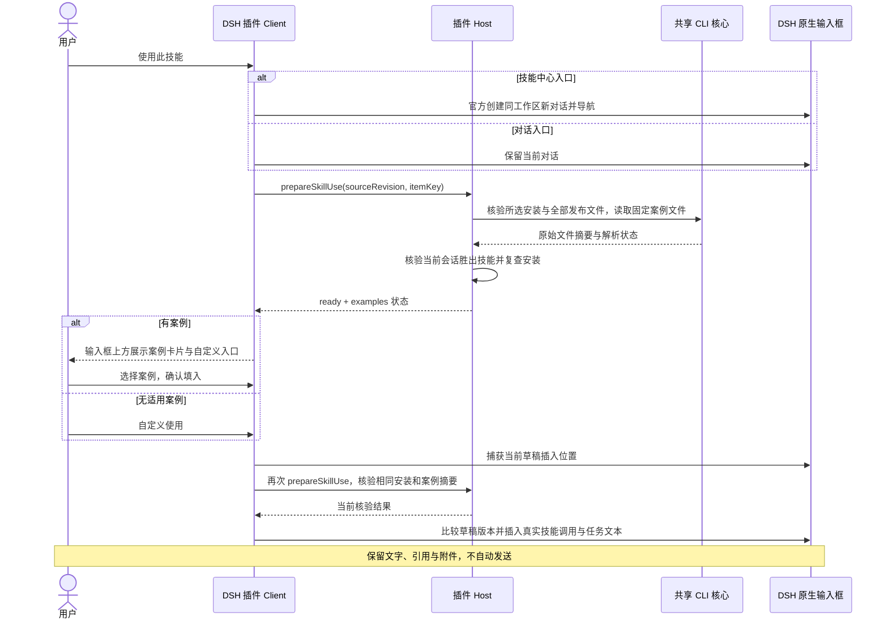

# 技能使用案例：协议与实现设计

本文承接 [使用设计](use-skill-design.md#技能专属使用案例固定文件约定)，定义本项目的固定案例契约。开源实现与本地验收已完成，结果见 [验证记录](verification.md#固定技能案例协议开源实现验收)；SaaS 后续适配。WorkBuddy 本机多案例文件提供交互与内容组织参考，不是本项目协议或兼容声明。

## 1. 文件协议

固定相对路径为 `.skillhub/examples.json`，随技能版本发布并原样安装，仅一份文件。作者不修改 SKILL.md，不在 Web 填写额外配置。示例：

```json
{
  "schemaVersion": 1,
  "defaultLocale": "zh-CN",
  "examples": {
    "zh-CN": [
      {
        "id": "meeting-summary",
        "title": "整理会议纪要",
        "prompt": "请使用 {{skill}} 整理会议记录，提取结论和待办。"
      },
      {
        "id": "compare-proposals",
        "title": "对比方案",
        "prompt": "请使用 {{skill}} 对比两份方案，列出差异、风险和待确认问题。"
      }
    ],
    "en": [
      {
        "id": "meeting-summary",
        "title": "Summarize meeting notes",
        "prompt": "Use {{skill}} to summarize meeting notes and extract action items."
      },
      {
        "id": "compare-proposals",
        "title": "Compare proposals",
        "prompt": "Use {{skill}} to compare two proposals and identify differences, risks, and open questions."
      }
    ]
  }
}
```

规范性 schema 为 [skill-examples.schema.json](contracts/skill-examples.schema.json)，有效样例见 [多案例](contracts/skill-examples.valid.json) 和 [空集合](contracts/skill-examples.empty.json)。这两份样例是协议文档素材，不是运行时默认案例，不自动写入用户技能。

| 项目 | 规则 |
| --- | --- |
| 编码/体积 | UTF-8，最多 65,536 原始字节；允许开头单个 UTF-8 BOM，解析时去除，存储和指纹不改字节 |
| 根结构 | schemaVersion、defaultLocale、examples 三个字段；schemaVersion 必须为整数 1 |
| examples | 语言标签到有序案例对象数组的映射，1–10种语言；每种0–20条，同一语言内 id 唯一 |
| 单条对象 | 必含 id、title、prompt，不接受旧字符串条目；不把数字、null 等自动转成字符串 |
| id | 1–64个ASCII字符，小写字母/数字以连字符分段；同一语言内唯一，同一逻辑案例的不同语言版本使用相同id |
| title / prompt | title为1–80、prompt为1–4,000个Unicode码点，均至少含一个非空白字符；空白由schema显式码点定义，不依赖语言的 \s/\S |
| 顺序 | 保留作者顺序，不按评分、语言或模型推测重排 |
| 语言 | 使用语言标签，如 zh-CN、zh-TW、en、ja、ko；支持范围为 schema 限定的基础语言及子标签，不声明支持所有 BCP 47 扩展；不自动翻译或识别文本语言 |
| 内容使用 | 仅以纯文本展示和带入草稿，不渲染不可信 HTML，不执行脚本或工具指令，不打开模板中的 URL |
| 扩展 | 未知字段或协议版本按不支持处理，不静默取部分内容；将来扩展需升级协议与消费者 |

语言选择规则：对宿主提供的界面语言和作者标签做规范化，依次匹配完整标签、逐级父标签，最后使用 defaultLocale。例如 zh-Hant-TW → zh-Hant → zh → defaultLocale，不能把 zh-TW 自动当成 zh-CN。若宿主未提供可用语言，直接使用作者默认语言，不读取浏览器语言覆盖 Host 上下文。同一文档内规范化后重复的语言键不合法；defaultLocale 必须对应实际声明的键。这两项及各语言集合内 id 唯一性为 schema 之外必须执行的语义校验。首期不增加语言切换控件。

命中的语言数组若明确为空，直接视为没有案例，不继续跨语言兜底。一次只展示一个语言集合，不混排中英文；语言切换使旧选择失效。文件64KiB上限覆盖全部语种，单条长度与数量规则按各语言数组执行。允许某案例只提供部分语言，不要求各语言数组数量一致；不得用数组位置匹配翻译。

超出案例解析体积、格式不合法或结构不合法，只意味着不识别为案例；通过通用包策略的原始文件仍保留。违反通用包大小、路径或安全规则仍按原规则拒绝。不能因案例识别失败就跳过文件哈希。

### 技能占位符与插入文本

`prompt` 仅支持精确占位符 `{{skill}}`，代表核验后的 DSH 原生调用（例如 `/document-helper`）。实际值来自当前会话胜出技能的真实名称，不使用市场 slug、展示名称或作者传入路径猜测。`id`、`title` 不做占位替换。

- 有占位符：逐字替换所有精确的 `{{skill}}`；不解析模板表达式、过滤器或任意变量。
- 无占位符：在 prompt 前补一行包含已核验原生调用的引导，再接作者任务文本；若现有草稿已含相同原生调用，可省略重复引导，但仍须插入明确选择的任务。
- 其他类似 `{{...}}` 的文本保持字面值，不执行、不请求模型补值；本期没有其他可用变量。
- title用于卡片标题，prompt作为纯文本预览与最终任务内容，不能把title当执行指令。

## 2. 解析与数据状态

共享 TypeScript 解析器由 CLI 核心提供，插件通过已有内置核心消费，避免 CLI 与 DSH 自建两套规则。服务端预检按相同 schema/样例识别摘要；不增加 JSON Schema 运行时生产依赖作为前提。

| 状态 | 触发条件 | 产品行为 |
| --- | --- | --- |
| ready | 文件符合支持的协议，保留原始摘要与全部语言集合 | 按宿主语言选择；有条目时展示案例列表和自定义任务，命中空数组时直接自定义使用 |
| none | 确认 ENOENT | 不展示空选择区，直接自定义使用 |
| invalid | 可读取，但 JSON、结构、版本、编码或解析上限不符合协议 | 不展示案例，普通文件保留；作者预检给非阻断提示，使用端保留自定义入口 |
| unavailable | I/O、权限或读取中断，无法确认内容 | 提示暂时无法读取；只有既有技能使用核验通过才允许自定义，不能伪装为无案例 |

不把取消或来源/会话失效作为 none 返回。文件完整性失败、符号链接或安装身份失效继续阻止使用，不能利用自定义入口绕过。

## 3. 本地读取与原生草稿衔接



复用现有 agent-scoped prepareSkillUse 的参数和上下文校验，扩展 ready 返回值，不新增模型工具或任意路径读取 RPC。返回类型如下：

```ts
type SkillExample = { id: string; title: string; prompt: string };
type SkillExamples =
  | { state: 'ready'; digest: string; defaultLocale: string; items: Record<string, SkillExample[]> }
  | { state: 'none' }
  | { state: 'invalid' }
  | { state: 'unavailable'; retryable: boolean };
// 现有 ready.name/version/scope 保留，新增 examples: SkillExamples。
```

`digest` 为案例原始字节 SHA-256，摘要不作为安装权限。Host 返回全部有界语言集合，Client 按宿主界面语言选中集合；确认状态须保持所选 locale 一致。Client 只保留所选安装标识、摘要、语言和案例 id；最终核验重新返回同摘要，且宿主界面语言未变后，使用当前返回的所选语言集合中该 id 的 prompt，不信任第一次响应中的陈旧文本。模板选择期间安装、来源、范围或会话变化立即使选择失效；摘要不匹配不得自动替换为新案例。

点击选择面板的“填入输入框”才捕获当前插入位置；初次打开面板不改草稿。最终异步核验期间用户修改草稿则比较失败，保留其内容并提示重试。即使真实技能调用已存在，用户明确选择的新模板仍应可带入，不能沿用旧逻辑“发现调用 token 就忽略全部插入”；重复提交同一次动作仍需去重。

案例读取需在可信目标路径下执行，限制字节、拒绝符号链接，与前后文件快照绑定；不能在完整性复查后另读未经核验的版本。传输只返回有界文本，不返回本地目录、内部 metadata 或文件读写能力。

## 4. Registry 与 Web 边界

技能安装时案例随 ZIP 获取，不单独下载或刷新。已安装使用路径不请求市场最新案例，不新增案例表、可变服务端配置或专用 `/examples` 接口。

既有原始文件接口可供作者和版本文件浏览使用：

```text
GET /api/v1/skills/{namespace}/{slug}/versions/{version}/file?path=.skillhub%2Fexamples.json
```

响应是原始文件流，不是 ApiResponse.data JSON。路径分段与 query 需分别编码，权限和版本可见性沿用既有文件接口。本期不新增安装前案例选择或远程模板预览。

现有服务端部分缺失/对象存储读取错误都映射为 HTTP 400；不得把任意 HTTP 400、404 或网络错误自动归类为没有案例。本期本地使用无需修改该通用接口错误语义。

Web 复用现有发布预检，不增加表单。为实现非阻断作者提示，现有 SkillPackagePreviewResponse 增加可选 `examplesStatus: 'ready' | 'none' | 'invalid'` 和 `examplesCount`；这两个字段为向后兼容的可选扩展。examplesCount统计全部语言集合的条目总数；合法文件总数大于0为ready，合法全空或无文件为none且count=0，invalid不返回count，旧响应缺字段表示未知。此预检状态不等于某个界面语言实际可选条数。只返回识别摘要，不在预检返回第二份案例权威内容；旧响应缺少字段视为未知，不显示错误提示。OpenAPI 生成类型与消费方测试同步维护。CLI 以共享解析器对待发布文件作同样非阻断提示，不把提示混进 --json 的纯 JSON 输出。

预检统计示例（与DSH实际选中语言的条目数区分）：

| 文件内容 | 预检结果 |
| --- | --- |
| zh-CN为空，en有1条 | ready，examplesCount=1；DSH选中zh-CN时仍不展示案例 |
| zh-CN和en各1条同id翻译 | ready，examplesCount=2，不按逻辑id去重统计 |
| 所有语言集合为空，或没有文件 | none，examplesCount=0 |
| 文件无法识别为协议 | invalid，省略examplesCount；旧接口无摘要字段为未知 |

## 5. 发布内容与内部安装记录

| 路径/入口 | 规则 |
| --- | --- |
| `.skillhub/examples.json` | 合法或非法协议均按原始字节进入包、manifest、指纹与安装目录 |
| `.skillhub/metadata.json` | 仅安装器生成，排除内容指纹；不接受作者上传的安装身份 |
| `.skillhub` 其他安全作者文件 | 普通版本文件，不识别为案例，不静默删除；纳入发布清单和完整性校验 |
| CLI 发布目录、sync push、Web 文件夹打包 | 遍历 .skillhub，仅排除根目录内部 metadata.json，保留作者文件 |
| 手工 ZIP 或直接 HTTP 上传 | 服务端共享包验证器对规范化后的内部 metadata 路径明确拒绝，返回可操作错误；不能只依赖 Web 过滤 |
| 下载/本地安装 | 生成内部记录前再次拒绝包内内部 metadata，避免旧来源绕过校验；失败不发布目标或 inventory |

路径判定在包根目录归一化后进行，覆盖分隔符、`.`、重复目标、大小写别名及文件/目录冲突；在跨平台存在歧义时明确拒绝，不能误将作者文件映射成内部记录。禁止符号链接、越界和不安全文件的规则保持。不能用 substring 匹配剥掉所有叫 metadata.json 的资源。

## 6. 指纹、恢复与兼容发布

目前 CLI/shared-core 跳过整个 .skillhub，原生恢复检查也只接受 metadata.json。两处都必须改：指纹按所有作者原始文件计算，仅排除安装器内部记录；安全目录检查结合精确 manifest 保留所有者和普通文件检查，未知增加的文件继续被视为本地改动。所有恢复/清理调用点均须审计，不得简单移除 guard 后扩大删除范围。

服务端与客户端必须采用一致的路径排序、SHA-256 和聚合格式，不新建单独“案例指纹”。套件和同步复用共享内容策略，不复制模板解析或生命周期管理逻辑。现有发布版本的 ZIP、manifest 和 fingerprint 不追溯重算。

已静态核实正式插件 0.3.1 的内置核心仍跳过 .skillhub 且拒绝额外文件，因此它不具备新内容规则。不能承诺“旧插件透明支持带案例的包”。首期不新增服务端消费者协商协议，采用明确最低消费者要求与旧消费者安全拒绝策略：

1. 先完成并发布支持新内容规则的 CLI 和 DSH 插件，再推广包含该文件的技能版本；实际最低版本号待发布时填写，不预设不存在的包版本。
2. 新消费者必须兼容无案例的旧技能；历史含有被旧指纹排除的作者文件须先盘点。若存在，不得修改旧版本指纹或无提示重新认领，需单独迁移设计；未完成前不能宣称该历史子集受支持。
3. 旧消费者遇新包允许在指纹/安全检查处拒绝，但必须验证目标与库存未被覆盖；不能声称旧包会显示新代码才有的友好提示。
4. 新安装目录被旧消费者访问时，分别验证旧原生 DSH 的内容保护与旧 CLI 的实际行为。旧 CLI remove 原本直接删除目录，强制重装也可覆盖，不能承诺它们会因新文件而拒绝；混用这些旧命令不属于支持的管理方式，应先升级消费者。不得为适配旧版伪造 metadata 或减弱指纹。
5. 代码发布与 npm 发布为后续独立操作，本轮完成开源实现和本地验证，不自动合并、部署或发布。

## 7. 实施切片与验证

| 切片 | 最小产物 | 必须验证 |
| --- | --- | --- |
| 协议与共享内容规则 | 共享解析器/路径策略、指纹、目录与 ZIP 处理 | 合法/非法文本均计入哈希；修改/删除/新增受保护；内部 metadata 不可上传 |
| 服务端与发布前端 | 包验证、Web 文件夹过滤、预检识别摘要 | 目录/手工 ZIP/直接 API 一致；无效案例非阻断；生成类型一致 |
| DSH 使用交互 | 复用 ready 投影、多案例选择与自定义 | 安装范围/版本一致、上下文与摘要复验、保留草稿附件、不自动发送 |
| 跨消费者验收 | 新旧公开包/候选、完整生命周期与真实 Host | 新→旧包、新→新包、旧→新包、旧访问新安装目录的真实边界 |

核心回归包括 install/retry/upgrade/remove/sync/publish/recovery/rollback/suite 与 Use；完整命令沿用 Makefile 的 lint-cli/typecheck-cli/test-cli/build-cli、插件 check 及 Web/后端受影响测试。具体文件与命令由本地执行计划链接当前源码测试，不把源代码审计当作端到端通过。

schema 样例检查与运行时验收分别记录。生产 parser、预检可选字段、生命周期及双 DSH 基线的开源验收结果见 [验证记录](verification.md#固定技能案例协议开源实现验收)；SaaS、Windows/macOS 原生宿主和 npm 发布不包含在本轮。


实施顺序、开源与SaaS范围及验收门禁见 [执行方案](skill-examples-execution-plan.md)；SaaS对应增量见 [专用交接Prompt](skill-examples-saas-agent-prompt.md)。
