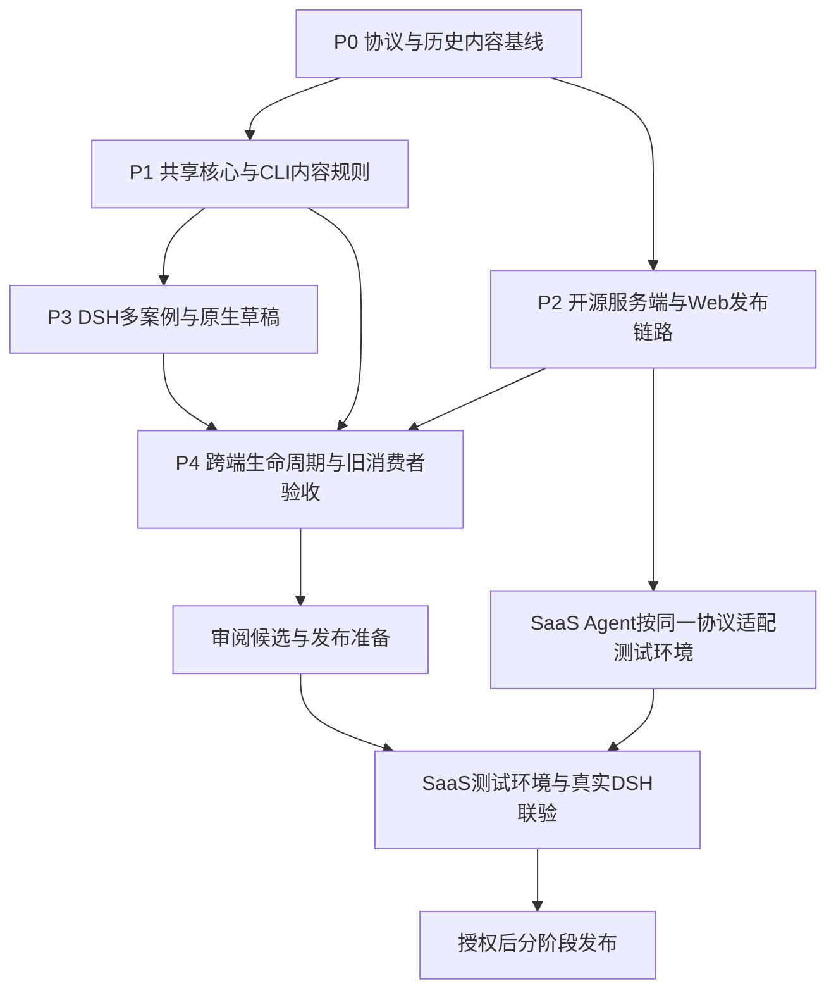

# 技能使用案例：执行范围、实施顺序与 SaaS 同步

## 1. 目标与当前状态

在 DSH 点击“使用此技能”后，用户可以选择该技能的本地版本案例，或自定义任务，再将包含真实技能调用的内容填入原生输入框。案例固定为技能包中的 `.skillhub/examples.json`，采用多语言 id/title/prompt 对象与 `{{skill}}` 占位符，随技能版本更新。

协议唯一来源是 [案例实现设计](skill-examples-design.md) 与 [JSON Schema](contracts/skill-examples.schema.json)，本文只确定执行范围、依赖和验收，不定义第二套协议。

开源实现与本地验收已完成：共享核心和 CLI 保留随包案例并纳入指纹，开源后端/Web 提供非阻断预检反馈，DSH 支持多语言案例选择、末次核验与草稿衔接。完整检查、真实后端和双 DSH 浏览器结果见 [验证记录](verification.md#固定技能案例协议开源实现验收)。改动尚未提交或发布；SaaS 实施与联验后续另做，不作为本轮完成前置。

## 2. 范围与责任

| 模块 | 本轮开源研发范围 | 不在本轮范围 |
| --- | --- | --- |
| 作者协议 | 固定文件、字段/语种/占位符校验、可复制说明及样例 | 作者填写额外Web表单、修改SKILL.md、生成案例内容 |
| 共享CLI核心 | 包路径策略、解析器、完整性指纹、内部记录保护；安装/升级/同步/恢复接缝 | 独立案例缓存、自动修复作者JSON、案例独立刷新 |
| CLI | 目录发布与sync push保留作者文件，非阻断协议提示，正常管理带案例技能 | 新增案例管理命令、改变既有remove/force产品语义 |
| 开源服务端 | 上传路径与内部metadata边界、发布预检识别摘要；核验版本文件/ZIP/指纹链路 | 新案例数据库表、案例编辑API、独立案例版本或CRUD系统 |
| 开源Web | 文件夹打包精确过滤内部记录；现有发布页显示识别结果/非阻断提示 | 案例编辑器、语言配置页、市场案例展示新页面 |
| DSH Host | 可信安装目录读取、解析状态与摘要投影、复用现有prepareSkillUse | 任意路径读取RPC、模型执行或新增服务端安装任务 |
| DSH Client | 多案例面板、语言选择规则、标题/正文预览、自定义、占位符与原生草稿衔接 | 语言切换设置、自动翻译、自动发送、输入材料变量系统 |
| SaaS | 本轮提供独立交接文档和一致性测试清单 | 本轮直接修改SaaS仓库、数据库、部署或生产内容 |
| 发布 | 本轮确定依赖和门禁，研发后准备可审阅候选 | 自动提交/合并、tag、npm发布或上线 |

共享核心改变后套件等现有消费者需要回归，但本轮不增加DSH套件产品能力。不将不同源手工技能纳入SkillHub案例管理。

## 3. 实施顺序与交付切片

| 阶段 | 具体动作与产物 | 退出条件 |
| --- | --- | --- |
| P0 基线 | 固定schema/样例，记录实际检出基线；本地夹具建立旧包/新包/非法案例/内部记录冲突；确认宿主语言来源；盘点可访问历史包是否存在已被旧规则忽略的.skillhub作者文件 | 设计冲突解决；未知历史子集明确标注；不访问未授权生产数据 |
| P1 共享核心与CLI | 统一根相对路径策略；指纹纳入作者文件、仅排除内部记录；解析对象/语言/占位符；修正目录发布和sync；审计恢复/回滚所有调用点 | 有效/无效案例字节均保留，未知新增/修改仍被保护；内部metadata不可伪造；CLI范围检查通过 |
| P2 开源服务端与Web | 校验预览和发布共用内部记录拒绝规则；保留examples；现有预检响应增加可选识别摘要；Web目录打包精确过滤，显示非阻断提示；生成API类型 | 手工ZIP、文件夹、直接API一致；无案例旧包正常；存储清单/下载/resolve指纹一致 |
| P3 DSH消费与交互 | prepareSkillUse扩展有界对象投影；使用界面语言→父语言→作者默认；面板标题/正文、按id选择、自定义；确认时复验摘要/语言/安装/草稿并替换真实调用 | 多入口共用，取消不写草稿；保留文字/引用/附件，不发送；语言与安装范围不串用 |
| P4 端到端与兼容 | 使用实际打包候选和旧公开包完成兼容矩阵；真实本地Registry与双RC官方Host跑生命周期、浏览器及原生输入框 | 记录通过/失败/不支持，独立review无阻断问题；不以mock或schema检查代替产品验收 |
| P5 交付准备 | 清理临时证据、回写OpenSpec与双语使用说明；提交/PR及包发布按后续授权执行 | 候选、检查记录和未验范围可审阅；不擅自发布 |

P1和P2可在协议固定后分别实施，但必须使用同一组路径/字节夹具；P3可以先用受控解析夹具开发，P4必须依赖完整真实链路。先运行最小测试，再运行受影响模块完整检查。

## 4. 开源代码接缝

下表为已核对的当前文件，不要求为匹配规划而重命名或复制现有模块；新增helper位置由实现时的最小复用决定。

| 责任 | 现有接缝 |
| --- | --- |
| 指纹与发布打包 | `cli/src/services/skill-fingerprint.ts`、`cli/src/commands/publish.ts`、`cli/src/services/sync-service.ts`、`cli/src/platform/archive.ts` |
| 安装记录与安全恢复 | `cli/src/services/install-service.ts`、`cli/src/integrations/recovery-files.ts`、`upgrade-baseline.ts`、`native-installed.ts`及所有恢复调用点 |
| 服务端路径/包检查 | `server/skillhub-domain/.../skill/validation/SkillPackagePolicy.java`、`SkillPackageValidator.java`，以及上传提取的包根归一化 |
| 预检识别摘要 | `server/skillhub-app/.../service/SkillPackagePreviewService.java`、`dto/SkillPackagePreviewResponse.java` |
| 版本内容核对 | `SkillPublishService`文件manifest/存储与`SkillQueryService.computeFingerprint`；现有服务端按全部SkillFile聚合，若已符合则只补测试，不重写算法 |
| Web发布 | `web/src/features/publish/folder-zip.ts`、`web/src/pages/dashboard/publish.tsx`、现有查询hook/翻译资源、生成的API类型 |
| DSH使用 | `plugins/dsh/src/host/index.ts`的prepareSkillUse、`host/types.ts`、`src/client/use-skill.tsx`及既有使用入口 |

公开API新增字段仅限已有预检响应的可选识别摘要，旧响应缺字段保持兼容；精确返回字段见案例实现设计。已有版本文件接口已经返回原始内容流，安装后Use无需额外网络请求。实现如发现还需新端点、表或安装状态字段，先回到设计评审，不能扩大范围后再补文档。

## 5. SaaS 后续同步：必须、条件项与无需调整项

SaaS实际模块名称、数据结构和已部署行为需由SaaS Agent核实；下面是目标契约，不是已完成状态。

| SaaS项目 | 必须达到的行为 | 是否必改代码 |
| --- | --- | --- |
| 文件接收和存储 | 不丢弃/改写.skillhub/examples.json；合法、非法协议均按普通安全文件保留 | 先对照，已符合则补验证 |
| 预检和正式发布 | 同一规范化路径下，拒绝上传内部metadata；合法协议识别多语对象，非法仅非阻断提示；不能绕过扫描/审核 | 对照后补缺口 |
| Web文件夹上传 | 只过滤根目录内部metadata，保留examples和其他允许作者文件；无案例编辑表单 | 若有目录上传或既有过滤则同步 |
| 清单、ZIP、resolve指纹 | 作者文件全部覆盖且算法与新消费者一致，原始字节/版本/坐标对应 | 核验为必需，算法已一致不改 |
| 精确版本文件读取 | 如已有通用file接口则复用，返回原始字节；权限/租户/可见性不变 | 现有能力充足不新增接口 |
| 发布提示摘要 | 若复用开源Web预检体验，同步可选examplesStatus/examplesCount及OpenAPI类型；不得影响旧客户端 | SaaS有相同预检入口时实施 |
| 本地技能管理/案例选择/占位替换 | 由CLI与DSH负责，SaaS不读取用户项目或主机目录 | 不新增服务端能力 |
| 案例持久化 | 复用版本包文件、现有对象存储与文件清单 | 本期不新增案例表或数据迁移 |

SaaS的发布、审核、删除和版本复制流程都应自然保留该文件；若存在技能包重建/过滤中间层，必须补齐该层，而非只在上传Controller加字段。原始文件API及对象存储URL不能变成绕过私有技能或跨租户隔离的通道。

可直接交接的增量任务见 [SaaS案例适配Prompt](skill-examples-saas-agent-prompt.md)。旧的总体DSH交接见 [saas-agent-prompt.md](saas-agent-prompt.md)，不要重复实施已经上线的通用Registry能力。

## 6. 验收矩阵与完成定义

| 层级 | 核心场景 | 可观察结果 |
| --- | --- | --- |
| 协议 | 多语对象、空集合、非法JSON/结构/语种/id、上限和未知版本 | 解析状态准确；非法内容不变成案例，也不因此丢失文件 |
| 发布 | CLI目录、sync push、Web目录、手工ZIP、直接API | examples路径/字节保留；内部metadata精确过滤或明确拒绝 |
| 本地生命周期 | install/retry/upgrade/remove/sync/rollback/recovery/suite | manifest/库存/目录一致；本地案例改动受保护，恢复不误删未知文件 |
| UI | 多案例和自定义、语言回退/变化、占位符/无占位符、重复点击/取消 | 选择按id，真实name而非slug；保留草稿附件且无自动发送 |
| 上下文 | 用户/项目、同名覆盖、不同Registry/版本、读取期间切会话 | 不串用、不插入陈旧任务，不因模板存在跳过可调用性核验 |
| 消费者兼容 | 新消费者→旧无案例包、新→新案例包、旧→新包、旧访问新安装目录 | 用实际产物观察成功或拒绝/原行为，明确不支持混用，不假称全兼容 |
| SaaS测试环境 | 发布→精确版本读取/下载→新DSH安装→选择案例→升级/卸载 | 真实目标环境全链路成立；不能仅以HTTP200或单测代替 |

兼容发布顺序为：开源候选完成联验→授权发布支持新规则的CLI/DSH→SaaS适配测试环境联验→授权部署SaaS→推广带案例的新技能版本。SaaS研发可提前并行，不必等npm发布，但生产推广必须等兼容消费者可用。

新旧包与旧二进制不能全量透明兼容。旧CLI的remove/force行为沿原语义，新设计不能改变已经发布的二进制；旧DSH拒绝的具体动作需实际验证。历史包字节、版本号和指纹不得回算。出现历史被忽略作者文件时保持独立迁移门禁，不自动修改旧安装记录。

回退软件版本前先确认是否仍需管理新格式安装；优先停止推广新案例技能并保留已安装目录及可管理它的新消费者，不通过删除examples或伪造metadata来迁就旧客户端。SaaS应用回退不修改历史对象/文件清单。

本功能的确定性验收以原生草稿与文件生命周期为主，不要求真实模型调用来证明模板填入正确；若增加模型执行体验验收，单独记录模型配置、额度和真实对话证据，不把模型输出当作文件兼容证明。

完成定义：P1–P4实现与验证通过、文档/任务状态与证据一致、SaaS增量交接可执行。SaaS部署、npm发布及生产可用性为后续独立交付状态，不能被本地完成所代替。
