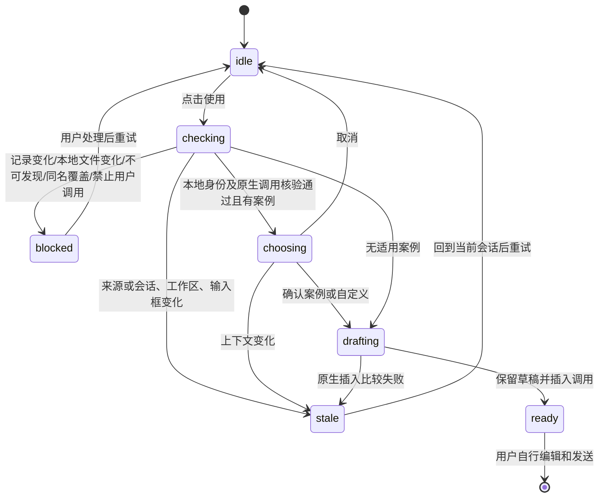
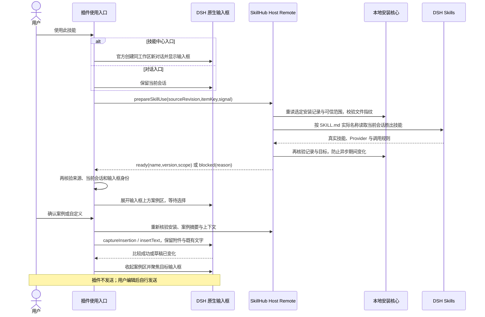

# 使用此技能：产品与实现设计

## 目标和边界

将“安装完成”衔接到用户发起技能任务。用户点击“使用此技能”，插件核验当前会话实际可用的本地技能，按入口选择新对话或当前对话，将原生技能调用和可编辑任务引导带入对应输入框。用户自行补充材料并发送；本功能不发送消息、不调用模型、不执行技能、不变更技能文件。

本期仅消费当前 Registry 的可信安装记录。场景助手、技能套件、专家中心、技能启停、自动执行、其他来源管理及 SaaS 接口调整不在范围内。不新增 HTTP API、模型工具或持久化使用记录。

## 产品交互

| 入口 | 展示条件 | 点击行为 |
| --- | --- | --- |
| 技能中心中的已安装卡片、已安装详情、匹配安装版本的市场详情与安装成功面板 | 当前范围记录为 present，或重读库存确认同坐标/版本/范围仍存在 | 在同一工作区创建新对话，打开原生对话页，再核验并在输入框上方展开案例区 |
| 对话中的详情、工具安装回执 | 当前库存包含所选同坐标、版本与范围 | 保留当前对话，在原生输入框上方展开案例区 |

入口复用小尺寸 shadcn Button 和 DSH 主题。技能中心不把新任务追加进原会话；原会话的文字、引用、图片与消息记录均保留。新对话必须属于进入技能中心时的当前工作区，不创建新项目、不猜测其他工作区、不沿用另一会话的安装授权。新建、切换与原生输入框挂载期间显示忙碌并去重；失败清楚提示，不写入旧会话，也不自动调用模型。

### 对话页案例区

- 使用 DSH 官方会话和输入框扩展能力，不替换宿主编辑器，不弹出第二个案例弹窗。
- 案例区置于目标对话的原生输入框上方，显示技能名称、可点击的案例卡片（标题与简短 prompt 预览）、取消、自定义任务及确认填入。
- 每种语言最多20条案例。多案例列表在有限高度内独立滚动，头部和底部操作固定；卡片行高按内容确定，不为容纳全部案例压缩行高。标题和正文预览分别最多2行，长英文单词/路径可断行，完整模板仍按原始prompt填入，不因视觉截断丢内容。面板最多两列，内容宽度不超过540px时切为单列；面板高度上限340px，与宿主输入框宽度变量对齐。最后一条可滚动到达、选择，底部确认保持可见。
- 模板与自定义任务写入空输入框时不额外添加首尾换行；插入已有正文时仅在紧邻内容且原边界没有换行时增加分隔。保留作者模板原有换行，不 trim 用户草稿或作者内容。引用 chip 按宿主 detect 投影判断边界，仍使用原生捕获的跨度与草稿版本进行比较插入。
- 对话详情中的“使用此技能”首次核验成功且驻留控制器接管请求后，关闭详情弹层，再展开输入框案例区；详情不得遮挡选择。首次核验失败保留详情与错误；取消案例不写草稿、不重开详情。无案例的自定义衔接保持成功填入后关闭。
- 展开案例区不写草稿。选择卡片后点击“填入输入框”才将对应模板带入；用户可继续编辑和补充附件，最后自行发送。
- 没有适用案例时不显示空卡片区，按既有核验流程带入技能引用与自定义任务提示；暂时读不到案例与确实无案例分别提示。
- 对话入口保留该会话已有文字、引用、附件；技能中心入口的新对话保持原工作区，所选安装范围不改变。用户级技能仍须核验当前项目中的实际胜出 Provider。
- 关闭案例区不填入、不发送、不删除对话；已创建的新对话保持为空供用户继续使用，不自动删除会话。
- 来源、目标会话、工作区、安装版本/范围、宿主语言变化时撤销陈旧选择；不能把选项或响应迁移到用户手动切换的另一会话。用户在案例选择期间可以编辑草稿，最终异步核验期间发生编辑则比较失败，不覆盖内容。

### 原草稿的原生生命周期保护

两个支持 RC 的原生会话在最后一个 retain 释放后会销毁输入 shell 并回收未发送附件，旧 RC 的语义引用也不能依赖草稿持久化恢复。因此新对话导航前，必须用官方会话 retain 保留存在文字、引用、附件或未结束输入状态的原会话，保留完整原生输入对象，不序列化/复制附件或查找 DOM。

用户返回原会话且 mainView 接管后释放临时保留；原草稿已清空/发送、会话移除或真实作用域失效、插件卸载时也应清理。创建失败或尚未切离原会话就取消时及时释放。最多保护 8 个仍含草稿的原会话；到达上限时在新建前拒绝本次动作，提示返回已有对话处理草稿，不驱逐旧会话或静默丢弃内容。空会话不占保护名额。

该机制保护本次运行期间的会话切换，不承诺跨浏览器刷新、关闭页面或插件停用的附件持久化；这些场景仍遵循宿主原生生命周期。两 RC 验收必须切回原会话实际确认文字、引用 chip 和可解码图片均仍存在，不能以新会话草稿正确替代此项。

### 会话与安装身份

新对话通过支持版本的官方创建和导航 API 建立；新对话的原生输入动作就绪后才允许选择与填入。记录绑定仍由 Host 提供，若新会话需要新的 opaque itemKey，必须在该会话重读库存，严格匹配原来源、坐标、版本和范围，不能改用 latest 或同名技能。新建前后的来源、工作区与活动会话都需复查；创建失败或用户中途导航时停止，不跳回抢占用户正在编辑的会话。

## 状态与失败处理



核验仅说明所选技能在核验时可用，不等于安全审核通过或任务执行成功。就地错误说明无法使用的原因；不展示内部路径、原始文件内容或冗长诊断作为常规结果。

## 架构与模块边界



Host 是安装身份与文件校验边界；Client 只提交 opaque itemKey 和 sourceRevision，不提交本地路径或期望技能名称。Host 复用 readInstalledItem、可信根解析和现有只读指纹校验，不复用会进入安装/卸载事务的执行函数。当前直接安装记录可以复用单目标只读 baseline 检查；共享所有权等暂不支持的记录明确阻止，不能使用整组升级 baseline 导致其他项目范围被误判。

临时 FileSystemSkillProvider 仅加载已验证目录，includeDefaultRoots=false、watch=false，始终 dispose，不注册远程 Provider。按真实 name 对比 DSH skills.get 的胜出目录、路径、正文、调用字段和 metadata。名称必须可由 DSH 原生用户调用语法准确表达，userInvocable=false 不允许通过自然语言绕过。

Client 在统一会话组合层封装服务，所有入口复用同一路径。使用原生 InputActions.captureInsertion / insertText 的比较机制保留内容与附件，不使用 DOM 查找、模拟按键、替换草稿、beginCommand 或自动 submit。服务身份比较使用 Cordis 的原始实例，不能把每次查询产生的新代理当成服务替换。异步期间检查 session 对象、cwd、来源 revision、活动会话、输入框服务及组件生命周期；取消和陈旧响应不写入另一个输入框。

## 插件 Remote 接口

| 项目 | 定义 |
| --- | --- |
| 方法 | agent-scoped prepareSkillUse(sourceRevision: string, itemKey: string, signal: AbortSignal) |
| ready | { status: 'ready', name: string, version: string, scope: 'user' \| 'project', examples: SkillExamples } |
| blocked | { status: 'blocked', reason: string }；reason 使用受控类型，Client 映射中文提示 |
| 上下文失效 | 沿用 skillhub/context-stale；没有副作用，不自动恢复或切换来源 |
| 返回限制 | 不返回本地目录、技能全文、附件内容；ready 仅用于当前一次原生草稿衔接 |

实际错误 reason 枚举与行为由同目录 [interface-design.md](interface-design.md#使用此技能只读当前会话核验) 及插件共享类型保持一致；新增接口由现有 Typert 构建生成，兼容两版共同 ABI。此接口不是模型工具，不接受调用路径、任意名称或文件写入参数。

## 兼容与验收

支持现有明确验收的 DSH 0.2.0-rc.2、0.2.1-rc.2。原生输入框相关模块按宿主服务声明加载；缺少服务时显示不可用，不用轮询或页面 DOM 兜底。

| 验收层 | 必须证明 |
| --- | --- |
| Host 行为 | slug 与真实 name 不同、文件/资源被改、记录/来源/会话变更、项目覆盖用户级技能、禁止用户调用、未发现、取消和服务失效 |
| Client 行为 | 三入口共用、版本/范围准确、原生草稿比较、保留文字附件、重复点击、异步切会话/来源/输入框、无自动发送 |
| 构建 | 固定 Bun 版本的完整插件 check；契约生成、lint、类型与全部插件测试 |
| 双 RC 真宿主 | 隔离 Profile 安装候选，真实浏览器完成三入口、原生编辑器草稿与附件、失败不污染草稿；记录宿主版本和实际产物 |

运行报告、截图和临时宿主不进入公开 PR。验收通过后在 verification.md 写入简短结果与证据位置；尚未执行的项保持未勾选。模型执行不是“带入草稿”的验收前提，不能把无模型浏览器测试称为真实模型验收。本轮不发布 npm。


## 技能专属使用案例：固定文件约定

### 产品与范围

案例是技能作者提供的可复用任务模板，同一技能支持多条，不同技能拥有各自的模板集合。点击“使用此技能”时，有适用案例则展示选择面板，并提供自定义任务入口；无案例的旧技能仍可自定义使用。选择结果形成可编辑任务草稿，延续既有真实技能核验、原生输入框比较插入、保留文字和附件、不自动发送的边界。

首期采用固定位置文件、随技能版本发布的方案。不建设 Web 案例编辑器或独立配置入口，不修改 SKILL.md，不生成虚构案例。此前讨论的外置缓存、两份案例文件、独立刷新案例和作者更新 API 不属于本期方案。

### 唯一文件位置

```text
技能目录/
├── SKILL.md
└── .skillhub/
    └── examples.json
```

作者上传的技能包与安装后的技能目录保持相同相对路径：`.skillhub/examples.json`。不将文件改名或复制为另一个案例副本，不在浏览器、插件安装目录或 DSH 全局缓存另建权威案例文件。案例默认属于所安装的技能版本，更新案例通过发布及安装相应技能版本完成；切换版本不得沿用另一版本的案例。

`.skillhub/metadata.json` 是安装器内部身份与生命周期记录，与作者案例文件职责不同。上传内容不得覆盖、伪造或获得该内部记录的信任；其上传处理规则按 [案例实现设计](skill-examples-design.md#5-发布内容与内部安装记录) 执行，并在实现中验证。不能因为 examples.json 合法就信任整个 .skillhub 目录。

### 自动识别与失败处理

| 输入 | 目标行为 |
| --- | --- |
| 指定路径的 JSON 符合案例协议 | 识别为当前技能版本的多条任务模板 |
| 指定路径存在，但 JSON 无法解析或不符合案例协议 | 按普通技能文件原样保留，不启用案例功能；发布结果提供简短非阻断提示 |
| 指定文件不存在，或合法协议明确没有案例 | 不显示空案例区，保留自定义使用 |
| 其他位置的 JSON 或相似文件名 | 按普通文件处理，不猜测或全目录扫描识别案例 |
| 文件违反通用路径、类型、大小或安全规则 | 沿用原有拒绝或安全处理，不得以“普通文件回退”为由放行 |
| 文件读取发生 I/O 错误 | 与明确无案例区分；可提示重试，保留自定义入口，不绕过技能完整性核验 |

协议识别失败不等于技能发布、安装或使用失败；但普通文件仍属于技能内容，不能静默忽略修改、删改或执行其中内容。JSON 中的模板只作为用户可编辑文本，不能作为权限、工具调用、路径或安装身份依据。

协议、状态、接口投影、内部记录保护与旧消费者策略见 [案例实现设计](skill-examples-design.md)。首期采用 schemaVersion=1、defaultLocale 和按语言标签组织的 examples 对象数组映射；每条包含 id/title/prompt，prompt 支持 {{skill}} 占位符；规范 schema 与样例由该分册链接，本节不重复维护。

### 分发和消费边界

作者经现有技能包上传/发布链路提供文件。服务端识别结果必须绑定精确的来源、技能坐标与版本；如通过 API 展示案例，API 只是该版本文件的投影，不构成独立编辑或独立更新源。本期复用既有精确版本原始文件接口，不新增案例表或专用端点；预检识别摘要与本地 Remote 投影见 [案例实现设计](skill-examples-design.md)，开源实现与本地验证见 verification.md；SaaS 另行适配。

DSH 的使用入口消费选定安装版本的固定文件，不能以市场最新版本模板替代已安装版本。用户级与项目级安装分别读取所选目录；不得跨来源、技能、版本或范围串用模板。案例存在不表示该安装在当前会话可调用，仍需执行既有只读使用核验。

### CLI、Web 与 DSH 生命周期兼容

固定案例的实现行为如下：

- CLI 按目录发布、同步推送及 Web 文件夹打包须保留 `.skillhub/examples.json`；不得继续笼统排除整个 `.skillhub`，也不得误带安装器内部 metadata.json。
- 服务端文件清单、每文件哈希、下载包与本地校验必须一致地覆盖作者案例文件；案例协议不合法时也按普通发布文件保留和校验。
- 共享指纹与安全目录检查须识别该明确路径，并保留路径、普通文件、符号链接和所有权防护。不能整体忽略 .skillhub 内文件的修改。
- 安装保留作者文件，升级按目标版本替换，卸载随技能清理；备份、回滚、恢复和套件生命周期遵守相同内容规则。
- 安装后修改案例文件按本地内容修改处理，沿用现有保护，不增加静默覆盖或强制操作。案例不作为独立可变缓存写回。
- 没有该文件的旧技能保持可用。旧版 CLI/插件与新目录规则的互操作须实测；不能承诺旧二进制自动兼容。若确有不兼容，应在实现前定义最低消费者版本或明确的阻止提示。

### 验收要求

1. 合法多案例、无案例、错误 JSON、错误结构和其他路径文件均按识别规则处理；普通文件回退不削弱安全检查。
2. Web 与 CLI 上传/目录打包、手工 ZIP、服务端存储及下载、安装目录的文件路径与字节一致；内部安装记录不得由上传内容覆盖。
3. 安装、同版本重试、同步、升级、卸载、恢复、回滚、套件及“使用此技能”均覆盖合法和不合法案例文件；本地修改继续受到保护。
4. 多模板选择、自定义、草稿/附件保留、取消和上下文变更不自动发送，不执行文件中的指令。
5. 不同来源、坐标、版本、用户/项目范围不串用；覆盖旧技能与实际旧版消费者兼容，记录支持边界。

开源实现及生命周期验证结果见 verification.md 的“固定技能案例协议：开源实现验收”。SaaS 和生产部署不在本轮范围。
