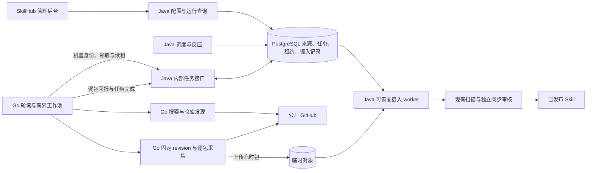

## Context

> 已实现增量：官方深度探索扩展原有元数据发现范围，新增 README 与有界作者扩展，采用独立页面和独立探索开关。产品决定见[需求](deep-discovery.md)，技术合同见[增量设计](deep-discovery-design.md)，当前验收范围见[验收追踪](verification.md)。下文仅元数据搜索及只按自定义规则启停的原有入口边界不适用于官方探索；自定义规则继续兼容。

设计前基线（新增能力前），见 [proposal.md](proposal.md)：原开源版只有 `GLOBAL`、`TEAM` namespace；`ReviewTask` 是共享审核表，尚无同步来源标记；`ObjectStorageService` 只有预签名下载 URL，没有预签名上传能力。现有 `SkillPackageValidator`、发布领域逻辑、扫描任务和审核权限可复用，但不能让外部采集结果直接进入发布状态。现有 `SkillPublishService` 有超级管理员直接发布分支，且同步写文件与对象存储，不能原样用作 Go 回报入口。Trellis 访谈记录保留在本机，不作为第二份正式规格。

## Goals / Non-Goals

**Goals:**

- SkillHub Java 始终是来源、任务、凭证、Skill 版本和审核的事实源；独立 Go 服务承担 GitHub 外部访问与采集负载。
- 一个仓库任务处理多个 Skill，同时做到逐包成功、失败隔离、固定 revision 和可恢复续跑。
- 管理后台能回答“配置了什么、发现了什么、为何延后、哪些 Skill 待审、下一步能做什么”。
- 无需 GitHub Actions、独立队列、独立 Redis 或额外证书管理组件即可私有化部署。

**Non-Goals:**

- Go 服务不解析 SkillHub 发布权限、不写 SkillHub 数据库、不直接发布 Skill；本期不支持私有 Git 仓库、其他托管平台、自动批准审核或审核发布方式开关。
- 不根据早期审核产出自动调节各搜索规则权重；先记录效果数据，等样本充分后单独评估。

## Decisions

### 1. 控制面与单 Go 执行服务

Java 保存来源、规则、运行、仓库检查点、任务租约、重试时间和凭证密文。一个 Go 服务部署包含发现与仓库同步两类工作池，主动向 Java 领取任务；工作池有独立并发及 GitHub 额度控制。自动搜索任务负责规则/精选用户的仓库召回；已登记仓库任务在一个租约下固定 commit、枚举 Skill 路径并逐包采集。平台精选仓库和 TEAM 明确登记的仓库直接进入同一个仓库账本。Go 不保持跨重启的业务状态。

任务合同采用版本化 HTTP/JSON，并以 OpenAPI 描述，至少包含 `claim`、`renew`、逐包采集准入、`report`、`complete/fail` 和短时上传授权操作。领取结果携带任务 ID、运行 ID、类型、namespace/source、规则版本或固定 commit、租约令牌与过期时间、必要的过滤与安全边界；GitHub Token 只在受认证的领取响应中临时提供，不写入任务记录。进度回报携带仓库 ID、commit、枚举覆盖范围、逐 Skill 路径结果、临时对象引用、额度与可重试时间。Java 只接受当前租约令牌和单调检查点；重放通过 `(任务, commit, Skill 路径, 内容哈希)` 幂等。一次仓库任务失败后可携带原 commit 与失败路径重新领取，不重新采集成功包。逐包 `report` 仅在短事务持久接受摄入记录后确认接收，Java 后台再逐包复核和推进审核；仓库采集任务完成不表示所有包已审核或发布。每个内部 HTTP 请求使用独立的 `X-Request-Id` 关联日志，业务幂等仍以任务、租约和结果键判断，不复用 request ID 充当业务检查点。

**备选：Java 为每个 Skill 拆采集任务。** 不采用。它增加任务量与中间状态，也违背已确认的仓库任务模型。逐 Skill 的结果、对象和重试目标仍单独持久化。

### 2. 统一来源账本与 namespace

新增系统管理的 `CATALOG` namespace 类型和保留 slug `github`，创建不可由普通用户删除的 `@github`。迁移发现现有 namespace 占用该 slug 时，停止初始化并给出明确迁移错误，不自动改名或删除用户空间。所有平台发现入口在 `@github` 以 GitHub repository ID 去重，`owner/repo` 只作展示与首次解析线索；同一仓库可在 TEAM namespace 形成独立来源绑定。来源记录保留发现入口集合、公开状态、同步开关、最近成功 revision、下次运行时间及不可达状态。

现有 `Skill.ownerId` 非空。同步 Skill 使用保留的系统 actor 作为技术所有者，业务归属以 namespace 和来源绑定为准；界面不将采集工作归属给配置管理员个人。TEAM OWNER/ADMIN 与平台审核角色仍按现有 namespace 权限执行操作，系统 actor 不成为可登录账号。自动搜索命中的仓库先保存为发现运行中的候选坐标，仓库任务验证有效 Skill 后才建立正式来源；管理员明确配置的精选仓库可以先建立来源并显示待首次扫描状态。

规则只决定新仓库召回；来源停用不会变成删除，搜索重命中不能自动恢复。TEAM 来源默认 `NAMESPACE_ONLY`，来源级可见范围只用于未来导入，已发布 Skill 的可见性遵守现有生命周期。

**备选：所有外部来源复用 `GLOBAL`。** 不采用。它无法表达 `@github` 的系统归属、不可删除规则和未来按平台区分的治理权限。

### 3. GitHub 发现、固定树与包采集

官方深度探索使用名称、描述、topic、README 线索以及有效仓库作者的一层扩展，配合历史补搜、分页和周期补漏；详细增量设计见 [deep-discovery-design.md](deep-discovery-design.md)。管理员自定义搜索继续使用元数据关键词和 topic 条件。首期默认策略不依赖全站代码搜索，后续需经过对照试验才可纳入。上述渠道仍受 GitHub 索引和查询范围限制，不能承诺全站穷尽。

现有自定义规则快照包含 `KEYWORD`、`TOPIC` 两类选择条件，以及 `CORE`、`EXTENSION` 处理优先级；每个条件编译成独立的 GitHub 仓库搜索查询，合并时按 repository ID 去重并保留命中出处。`KEYWORD` 限定仓库名称、描述和 topics，`TOPIC` 使用 GitHub 的 topic 过滤；不搜索 README 或代码。Go 转义条件值，拒绝原始查询表达式，Java 对后台输入与规则版本做权威校验。增量/七天全量的搜索窗口由 Java 固定在任务快照，Go 根据固定窗口和检查点续跑；核心条件先消耗发现预算，扩展条件在剩余额度内执行。GitHub 仓库搜索的每查询 1,000 条结果上限及 `incomplete_results` 标志必须显式处理：超过覆盖范围时按可行的时间窗进一步分片或标记未完成并续跑，不能把截断页记为全量成功。[仓库搜索限定条件](https://docs.github.com/en/search-github/searching-on-github/searching-for-repositories)、[REST 搜索限制](https://docs.github.com/en/rest/search/search)。

发现包含结构化的核心/扩展查询、精选用户或组织公开仓库枚举和精选仓库。Go 先读取公开仓库元信息并解析稳定 repository ID；搜索返回只是仓库线索，确认有效 `SKILL.md` 后才登记。Java 保存发现入口启用状态、策略或规则版本、目标周期、增量窗口和运行检查点，只为已启用入口生成兼容的发现任务。官方探索有独立开关但不是全局同步开关，自定义规则继续各自启停；Go 领取固定快照执行。首次部署及现有部署升级时预置搜索规则初始停用，由平台管理员在同一规则页面启用；明确登记的精选仓库不受影响。正常轮次采用有重叠的增量窗口；默认每 7 天安排一次去除增量时间限制的全量搜索，以找回遗漏的仓库线索，不代表整仓下载。仓库更新和精选用户或组织发现的默认目标周期均约 24 小时，广泛搜索约 72 小时，可由后台按类别调整。目标周期不是限流或反压下的执行时限；全量搜索仍受额度、预算和可恢复检查点约束，逾期未完成须继续而非丢弃。

每次仓库任务先固定默认分支 commit。Go 使用 GitHub REST 取得仓库元数据、搜索结果和树；递归树响应截断时按子树继续，无法枚举的子树标记 `INCOMPLETE` 并续跑，其他完整子树继续。平台默认忽略候选路径中任一目录段为 `.git`、`node_modules`、`.venv`、`venv`、`dist`、`build`、`target`、`__pycache__`、`test`、`tests` 的 `SKILL.md`；`examples`、`docs` 不默认忽略。管理员只能追加来源级候选路径规则，不能放宽平台基线；忽略候选不剔除父 Skill 包内的合法测试文件。Go 可使用 Java 下发的有效规则作采集优化，Java 导入前重新执行权威判断。包以 `SKILL.md` 所在目录为根，排除嵌套 Skill 子树；仓库根级许可证/NOTICE 作为来源合规证据一并记录。包文件首期采用容器内受限 Git CLI 的 blobless 局部克隆和稀疏读取，把固定 commit 下所需文件取到有时间、磁盘和文件数边界的本地临时目录，并在读包前验证检出的 commit 等于任务固定 commit；若固定 commit 无法安全取得，则报告失败或重试，绝不混用最新分支内容。Git 命令只能访问由公开仓库 ID 解析出的 GitHub 地址，使用参数数组而非 shell 拼接，禁用全局配置、hooks、外部过滤器和 submodule，限制时间、磁盘与输出大小。不以每个文件一次 Contents API 请求工作，也不回退为无限制整仓下载。符号链接和 submodule 不跟随；文件数、单文件与总大小采用当前有效发布策略，当前 `application.yml` 配置为最多 100 个文件、单文件 10 MiB、包总量 100 MiB，在 Go 预检且在 Java 复核；临时归档上传大小同样受已有上传限制。

**本地磁盘边界：** Go 必须先用固定 commit 的 GitHub Tree 元数据发现候选 `SKILL.md`、文件类型和 blob 大小，按子树逐步枚举而非将整仓清单无限驻留内存；确认路径不被忽略、包的文件数和已知大小未超限后，才启动该包的内容获取。GitHub 递归 Tree API 在 100,000 项或 7 MB 响应处可能截断，须按非递归子树续查；树不完整时不能推断 Skill 消失。[GitHub Tree API](https://docs.github.com/en/rest/git/trees) 返回 blob 大小与截断标志。`blob:none` 初始获取仍可能包含大量 commit/tree 元数据，稀疏检出又会按需下载所选 blob，不能把“局部克隆”等同于磁盘有界；[Git partial clone](https://git-scm.com/docs/partial-clone) 与 [sparse checkout](https://git-scm.com/docs/sparse-checkout) 只提供选择性获取机制。Go 的每仓库工作目录、进程总临时磁盘、最低剩余空间和并发目录数必须受部署资源预算约束，统计包括 `.git` 对象、检出文件和归档；逐包上传并收到 Java 接收确认后删除可释放的本地文件。Git 对象缓存可能继续增长，因此达到预算前应保存已处理路径检查点、结束本批并清理工作目录，再从同一固定 commit 续跑剩余路径；低磁盘须报告容量延后而不是继续下载或将来源标为不可达。单个包超过业务限制按该包失败，其他包继续；元数据或固定 commit 无法在预算内安全取得时标记扫描不完整并显示资源不足，不能自动删除既有 Skill。工作目录容量与并发的初始数值在 Go 镜像/Compose/Helm 的实际临时存储限制下确定并做大仓库试验，不能只在代码里设置一个未验证的常量。

执行前须为本批预留 Git 元数据、选中包的落地文件、归档和安全余量；业务包上限 100 MiB 不等于单包峰值磁盘需求只有 100 MiB。Go 在各阶段检查实际目录占用与文件系统剩余空间，写入失败时停止该仓库、清理未确认的临时文件并保留 Java 已确认的检查点。应用层检查存在采样间隙，部署时还须给临时工作区独立容量边界，并验证写满时不会侵占 Java/宿主机关键存储；Kubernetes 的临时存储限制可能通过驱逐 Pod 生效，不能把它当作每次写入前的精确拦截。若连固定 commit 的基础 Git 元数据或一个合规包都无法在当前预算下完成，同一配置下反复领取不会产生进展：Java 应展示容量阻塞并等待管理员调整容量或规则，不能无限立即重试，也不能把该包误判为业务超限。容量边界与一次批处理后可继续处理下一个路径的关系须在大仓库试运行中记录峰值和清理后占用。

Java 以规范化路径序列及对应文件字节计算正式 SHA-256 内容指纹，并把继承的许可证/NOTICE 证据纳入合规指纹；上游许可证变化因此需要重新核对。固定 commit 只是获取一致快照的坐标，不代替内容比较。路径移动仅在同仓库完整包指纹唯一匹配时自动绑定，否则进入冲突处理。完整扫描确认目录消失仅更新来源状态，不删除已发布 Skill；扫描不完整不触发缺失推断。

同 namespace slug 冲突时，Java 将受控冲突码及规范化目标 slug 留在摄入记录中；平台 `SUPER_ADMIN` 或该 TEAM 的 OWNER/ADMIN 可提供既有 Skill ID 与处理依据进行人工确认。确认事务锁定摄入项和目标 Skill，核对 namespace、slug、非归档、无普通用户待审项及无其他权威来源绑定，先以空的“最近已发布内容”指针预留来源路径，然后把该固定 commit 包重新排入发布流程。成功确认须留下操作者和依据的审计记录。只有待审版本创建成功的事务才将技术所有者改为系统 actor；失败时不改变原 Skill 内容或所有者。自动路径移动仍须等待同仓库完整扫描后唯一指纹匹配，不能用人工同名确认代替该判断。

**备选：整仓 clone 或每文件 Contents API。** 不采用。前者在超大仓库消耗不可控，后者易耗尽 API 额度；两者都不能替代包级上限。

### 4. 临时对象与正式版本隔离

Java 为每个包签发短时、限对象 key 且记录预期大小的上传票据。Go 先在本地临时目录把一个 Skill 的固定 commit 文件打包，再上传到隔离的临时对象存储；S3/MinIO 首期采用预签名 PUT，本地文件存储部署使用受服务身份保护的 Java 流式入口。Go 向 Java 回报 `uploadId`、固定 commit、路径、归档大小与 SHA-256，由 Java 通过自己的存储适配器把 `uploadId` 解析为临时对象并读取；回报和持久任务不传、也不保存预签名下载 URL 或任意外部链接。Go 无对象存储管理凭证，也不能写正式版本存储。预签名 PUT 不能仅凭签名保证服务端拒收超大对象，Go 须在本地预检，Java 在摄入前复核实际对象大小并清理超额对象，隔离暂存区域配置容量告警与清理；本地流式入口在接收时执行硬上限。Java 再校验摘要、解包边界、SKILL.md、忽略规则、内容政策与许可证；成功后才写入正式版本存储，暂存对象在消费后或确认无需保留时清理，并为失败清理保留补偿记录。

摄入端不得直接复用普通上传 Controller 的整包驻留内存解包路径。Go 的逐包回报由 Java 校验服务身份、当前租约代际、固定 commit、路径及临时对象元数据，在短事务中持久保存摄入记录后返回接受；Java 可恢复后台任务再逐包读取、校验、创建待审目标并触发扫描，单包失败隔离重试。Java 应先根据临时对象元数据执行包总量上限，再以有界、流式方式读取条目；任何需要把单文件内容物化的校验都受既有单文件、文件数和总量政策约束。现有 Skill Suite Bundle 的暂存对象流式读取可作为实现参照，但同步摄入需要自己的状态与来源校验。

**备选：Go 直写正式对象或共享存储密钥。** 不采用。采集结果不可信，且会扩大 Go 服务的权限与泄露半径。

### 5. 调度、额度与恢复

Java 使用持久任务、租约和唯一约束保证多实例领取；Go 在任务内续租并在停机时停止领取。调度按已登记来源更新与新配置精选仓库、精选用户发现、广泛搜索分层；TEAM 来源有公平份额。namespace 和全局“未解决同步项”高低水位控制反压：按 `(namespace, repository ID, Skill 路径)` 对当前最新目标去重，计入已接收、复核/扫描中、待同步审核和待管理员处理冲突的项；已批准、拒绝或被新目标取代的历史项不计入。达到全局高水位后，所有 namespace 停止**新包采集准入**；仅某个 namespace 达到高水位时，只暂停该范围的新包采集。Go 在取得每个包的文件内容之前须向 Java 申请一次原子准入；Java 将未完成准入计入占位，避免并发仓库任务越过水位。高水位后不得发放新准入，已获准且正在处理的包可完成或失败并释放占位；正在执行的仓库任务在下一个包前回报部分进度，不能继续下载兄弟包。

高水位期间，已启用的仓库搜索与精选用户或组织枚举可在 GitHub 额度及候选预算内继续，结果只作为按 repository ID 去重的**待验证仓库线索**和可恢复游标保存；不读取新候选仓库树、不下载包、不建立已验证来源或待审目标。候选预算满时保存游标并延后，而不是无限堆积候选。已登记仓库在额度允许时继续执行仅查询最新 commit 的轻量任务。Java 分别保存 `lastObservedCommit` 与 `lastFullyProcessedCommit`，前者只表示看见上游变化，不得推进后者或创建待审项；回落到低水位后重新核对待验证线索的当前仓库状态与已登记来源的当前 HEAD，再采集最新包，不补采所有中间 revision。每轮发现预算根据 GitHub 资源额度、重置时间、执行容量和未解决同步项数计算；超出候选保留检查点与延后原因。类别级配置的是 24/24/72 小时默认目标周期，限流和反压可以延后实际执行。Go 不长时间睡眠占租约，回报 `retryAt` 给 Java。

配额按 GitHub 返回的资源类别与凭证分别跟踪。无效或被撤销的凭证标记不可用并通知平台管理员；任务可改用另一健康的系统凭证，没有健康凭证时仅对可公开读取的仓库使用匿名额度。认证失败、仓库访问失败与 GitHub 限流分别归因；限流遵守响应的重试时间，不以连续轮换凭证规避。规则命中、有效 Skill、延后、失败、配额与积压进入同一运行视图；短期产出只用于观察，不自动修改规则权重。来源不可达按已确认的 24 小时、3 天、7 天低频复查节奏恢复，限流与网络暂时故障不等同于不可达。

**备选：固定每规则采集数量或 Go 长时间等待 reset。** 不采用。固定数量无法适应部署规模与审核积压；长等待占用租约和工作池。

### 6. 凭证与服务身份

GitHub 凭证在 Java 用部署提供的密钥加密保存，密文带密钥版本与随机 nonce，以便轮换。新部署凭证密钥应通过现有 Compose/Helm/Kubernetes secret 入口配置，不引入 KMS。平台后台只展示脱敏标识、有效性和额度状态；更新后不可读取明文。认证失效的凭证需要明确的健康状态与更新提示，不能把配额耗尽误标为失效。Go 调用 Java 内部接口使用专用服务密钥，不复用用户 Token 或 GitHub 凭证；密钥通过现有部署 Secret 提供，支持新旧密钥短期重叠轮换，Java 仅对内部路由验证该服务身份。优先复用已有 TLS，首期不强制 mTLS。Token 与服务密钥均不进入持久任务、普通 API、URL、日志、异常或指标标签。Go 只访问公开仓库，并复核仓库公开状态。

### 7. 版本审核与管理界面

Java 复用现有包校验、Scanner、Skill 版本与审核权限，在审核记录增加来源标记与同步绑定关联。Web 在既有审核区提供独立的“同步审核”入口，按仓库/运行分组但逐 Skill 决策；普通审核列表不混入同步项。新/变更内容先扫描再待审；只有最新上游目标可批准，旧目标保留审计但不再可批准。相同已拒绝指纹不反复排队。许可证或 NOTICE 证据和文件差异在审核页展示，`@github` 未识别许可证先阻止公开批准。同步内容不能在 SkillHub 内直接编辑。

普通技能和 GitHub 同步技能的详情页共用顶部对象说明、中部页级 Tab、底部固定审核意见栏。顶部始终显示扫描与许可证状态摘要，完整扫描卡片、发现项和来源证据在“来源与安全”Tab，摘要可直达详情；差异 Tab 以全宽单栏方式逐文件预览，不保留常驻文件或证据侧栏。复用现有开源 React 差异组件及审核绑定文件接口，按选中文件请求正文，维持大文件和非文本降级。审核意见位于 Tab 外，切换内容不丢失，扫描中、许可证依据及退回理由的原有服务端约束不变。

审核首屏不应无条件读取可能达到单文件上限的说明文档正文或审核历史。现有审核详情响应可用向后兼容的 `includeDocumentation` 查询参数控制是否读取文档：旧调用缺省仍包含文档，页面首屏仅取元数据；进入内容 Tab 后用受 256 KiB 服务端限制的单文件预览接口取得说明正文，不再重复请求整份详情。审核历史同样按 Tab 加载。来源响应继续先提供文件变化元数据，旧/新文件正文只对当前选中项读取。是否进一步拆分许可证证据响应，取决于浏览器网络测量结果。

平台管理区新增 GitHub 同步入口，信息结构为总览、发现规则、精选入口、来源、运行与额度、凭证；TEAM 在自身 namespace 页面只看到其仓库来源和运行结果。来源详情以仓库为主，展开逐 Skill 的最近 revision、同步/审核状态和失败原因；操作包括暂停/恢复、重扫、忽略路径及来源可见范围。手动重扫只调整合格任务顺序，不穿透配额或积压反压。

平台页把总览与已登记入口、运行列表、当前设置值常驻显示；新增仓库/账号/搜索规则，以及容量、周期和凭证编辑使用按需打开的弹窗。搜索规则的编辑与预览共处一处，新增后仍须在入口列表手动启用。弹窗关闭后清空未提交的凭证输入；密集运行/来源表在窄屏内部横向滚动，避免整页溢出。页内操作按钮保持紧凑，状态和配置摘要仍应易于辨认。

规则预览由 Java 排队、Go 实际搜索；Go 离线或状态未知时平台页面禁用预览并解释原因，仍允许保存为停用规则。页面把排队、领取执行、延后重试、失败和完成分开呈现，不能用“正在搜索”概括所有未完成任务。规则表单使用与后台一致的平面输入框、原生下拉框和可见字段标签，不采用大面积色块或发光聚焦效果。

## Risks / Trade-offs

- **GitHub 搜索遗漏或返回截断** → 增量窗口重叠、低频全量、规则与子树检查点；扫描不完整时禁止缺失推断。
- **超大仓库耗尽 Go 临时磁盘** → 先基于 Tree 元数据定向选包，限制工作目录及总临时磁盘，逐包清理与分批续跑；资源不足要可观察，不得回退为整仓下载。
- **审核队列积压** → namespace/全局高低水位停止新包采集准入；有预算地继续记录仓库线索和已登记仓库的低成本 HEAD 变化，候选满时保存游标延后；同步审核独立视图，暂不做未经验证的自动批准。
- **Go 失联、重复回报或部分上传** → DB 租约代际、幂等键、逐 Skill 结果、暂存对象 TTL 与补偿清理。
- **复用普通发布入口可能绕过同步审核** → 同步摄入使用独立编排，明确禁止超级管理员自动发布分支；正式版本仍复用可复用的校验与扫描能力。
- **Token 泄露或扩大权限** → 加密静态存储、短时任务响应、服务身份、日志脱敏、公开状态复核；无 TLS 部署仍须在部署说明中标注传输风险。
- **`@github` slug 已被占用** → 安装/迁移时阻断并给管理员明确处理路径，不自动移动现有 namespace。
- **本地文件存储没有原生预签名 PUT** → 用同一上传票据语义的 Java 流式端点，不要求客户部署 S3。

## Migration Plan

1. 增加来源、规则、运行、任务、凭证及来源绑定表/列；给 `ReviewTask` 增加同步来源判别，旧记录默认普通审核；创建系统 `@github` 时检查 slug 冲突。
2. 先部署 Java 数据/API 与后台页面，再部署 Go 容器与服务身份，完成匿名/单凭证、对象上传和任务领取联调；预置广泛搜索规则初始停用，平台管理员可在同一规则页面启用，试运行前不对公网启动无控制搜索。
3. 以少量精选仓库试运行，验证包级失败、限流、扫描、审核和停机恢复；逐步启用精选用户及广泛搜索。保留人工上传现有路径。
4. 回滚时停止新任务领取并关闭发现，保留已发布 Skill、待审项和运行历史；卸载 Go 容器不回滚领域数据。

## Open Questions

- 默认 24/24/72 小时目标周期、候选忽略目录、业务包限制、7 天全量搜索和运行记录保留边界已确定。首期继续人工同步审核，不提供自动发布或审核方式开关。长期无人审核时已确定继续有预算地发现仓库线索、暂停后续包采集；全平台 200/100、单 namespace 50/25 的高低水位建议偏低，不作为默认值。具体水位和候选预算须结合试运行的待审内容大小、存储与摄入能力确定；租约时长与轮询间隔由实施及小范围联调确定。
- Go 临时磁盘预算必须低于部署实际提供的存储边界；每仓库和总预算、保留空闲量及并发目录数要在大仓库小范围验证后给出部署默认值。已完成的同步运行/任务详情默认保留 90 天；未完成任务与恢复数据不能按天数清理，来源与审核审计按现有生命周期保留；容器标准输出日志由部署环境决定保留期。
- Java 后台摄入记录的具体状态名、重试上限和过期清理周期需在实施前与现有审核及存储政策对齐。

## Go 服务专项设计

已确认 Go 服务与 SkillHub 位于同一仓库，当前实现目录为 `github-sync-go/`，构建独立镜像并随同版本发布。采集能力可关闭，Go 离线不阻断人工上传、市场浏览与既有审核。首期默认部署一个 Go 副本，Java 的租约和幂等合同仍须允许后续增加副本，首期不交付自动扩缩容。Go 独立于工作池每 30 秒向 Java 报告一次在线状态；Java 只保存最近一次成功心跳，90 秒无心跳则后台显示离线。该状态与审核积压引起的新包准入暂停分别呈现。容量验收目标为每部署约 1000 个已登记仓库、10000 个 Skill 路径，不作为产品硬上限；先用少量公开仓库验证正确性，再用可控样本验证容量。接口字段、超时、续租时机和固定 commit 获取的异常路径仍需收敛并验证。

### 内部结构与数据流

单个 Go 进程划分任务客户端、发现执行器、仓库采集执行器、临时包上传器和运行观测五个边界。发现与仓库同步使用独立的有界工作池；两者共用按凭证和 GitHub 资源类别记录的额度状态，但不共享业务持久化。任务客户端只调用 Java 的内部版本化 HTTP/JSON 合同；不访问 SkillHub 数据库、Redis、普通用户 API 或发布接口。Java 仍决定任务优先级、租约、来源绑定、审核反压和版本状态。

仓库执行器先解析公开仓库稳定 ID 与固定 commit，再枚举树并形成逐 Skill 路径结果；包上传器仅使用 Java 签发的短时临时对象授权。已报告成功的路径由 Java 检查点记账；Go 进程重启后根据重新领取的任务与检查点恢复，不依赖本地工作目录。每个任务的工作目录有时间、磁盘和文件数上限，结束后清理。所有出站 GitHub 访问只能从解析后的 GitHub 仓库坐标构造目标，不能跟随仓库内容提供的任意 URL 或执行采集到的脚本。

Java 从 Go 的领取/心跳记录推导最近在线时间。Go 离线时，后台显示采集暂停与最近在线时间；相同来源的周期任务合并，保留下一次应执行时间与重扫意图，避免每个周期累积一份重复任务。Go 恢复后继续按来源优先级、额度和审核反压处理，不能把离线期间未执行的轮次当作成功同步。

### Java 与 Go 的模块落点

Java 新增一个 `skillhub-github-sync` Maven 模块，作为来源发现与同步控制面的功能模块，最终仍打包到现有 `skillhub-app` 进程，不额外部署 Java 服务。它包含来源、规则、任务、凭证引用和包摄入的模型、仓储接口、调度/摄入协调服务，负责来源绑定、最新可审目标和检查点推进。该模块可依赖现有 `skillhub-domain` 的 Skill/审核能力与独立的 `skillhub-storage` SPI，但不能依赖 `skillhub-app` 或 `skillhub-infra`；现有核心 `skillhub-domain` 不反向依赖新模块。`skillhub-infra` 依赖新模块并实现其 JPA 仓储、凭证加解密适配和原子领取；`skillhub-app` 依赖新模块，承载管理员/TEAM 配置入口、独立内部任务入口、运行查询以及与现有 Scanner/审核流程的装配；Flyway 迁移仍在 app。`skillhub-auth` 的机器身份校验不依赖新模块，由 app 给内部路由配置。`skillhub-storage` 扩展临时对象上传能力，S3/MinIO 使用限对象 key 的短时预签名 PUT，本地存储经 Java 受服务身份保护的流式入口接收。现有包校验、Scanner 和审核领域能力可复用；Go 回报不能直接调用普通发布入口，因为现有 `SkillPublishService` 包含超级管理员直发分支。新摄入编排必须始终先建立待扫描/待审目标。

这个模块应交付完整的同步状态机和少量面向 app 的操作，而不是为每个表各加一层透传服务。新增模块需要同步更新 `server/pom.xml`、`skillhub-app` 与 `skillhub-infra` 的依赖，以及 `server/Dockerfile` 的 Maven 缓存阶段；仓库现有 `skillhub-search` 和 `skillhub-notification` 已提供独立功能模块的先例。

Java 的定时调度只创建或合并到期任务；PostgreSQL 任务表是唯一持久队列，领取在事务中以行锁/`SKIP LOCKED` 或等价原子条件更新完成，并生成租约代际。所有 Java 实例均可参与调度与后台摄入，但唯一约束防止重复任务，租约令牌防止旧 Go 进程继续回报。逐包回报只在摄入记录与暂存对象引用持久化后确认；后台 worker 在独立短事务中读取受限临时对象、重新校验并推进 Scanner/审核。摄入队列积压期间须保留临时对象直到消费或明确失败，不能仅凭固定 TTL 清理尚待处理的已接收包。仓库树不完整或某个包仍需重试时，保留路径级进度；`lastFullyProcessedCommit` 只能在完整枚举且所有应处理路径已有终态后推进。

内部路由采用独立的机器身份校验，只赋予领取、续租、临时上传授权和回报权限；浏览器会话、普通用户/API Token 不可调用，内部路由也不能落入“仅需已登录”的默认规则。仅对这组内部路由采用无会话认证及相应的 CSRF 处理，不改变用户 API 的安全策略。现有 `IdempotencyInterceptor` 未在 MVC 配置中发现注册，因此 `X-Request-Id` 只用于日志关联；真正幂等由租约代际、逐包业务键和 PostgreSQL 唯一约束实现，不依赖该拦截器。

Go 建议保持一个独立 Go module 和单个二进制；`cmd/` 只做配置加载、依赖组装和优雅停机，`internal/controlplane` 封装版本化 Java HTTP 合同，`internal/github` 封装 REST、额度判断和受限 Git CLI，`internal/discovery` 做规则执行与仓库召回，`internal/repository` 做固定树、Skill 根枚举与包归档，`internal/worker` 管理两类有界工作池、领取、续租及恢复。每个内部模块只暴露少量完成一项工作所需的接口；Go 不持有数据库、Redis、发布业务对象或跨重启检查点。GitHub 出站客户端与 Java 内部客户端使用分开的 HTTP transport，避免部署级 GitHub 代理误代理内部请求。Go 关闭时停止领取、取消或限时收尾在途任务，让租约过期后由 Java 重派。

建议的代码布局如下，属于新建方案，当前仓库尚无这些 Go 文件：

```text
github-sync/
  go.mod                    # module github.com/iflytek/skillhub/github-sync
  cmd/skillhub-github-sync/ # 单个进程入口
  internal/controlplane/    # Java 任务合同客户端
  internal/github/          # REST、Git CLI 与额度
  internal/discovery/       # 规则执行和仓库召回
  internal/repository/      # 固定树、Skill 根和包归档
  internal/worker/          # 有界执行、续租、停止
  Dockerfile
```

Go 没有面向业务的入站接口或对外 Ingress；仅保留健康检查与可选的内部指标抓取入口。Java 不需要连接 Go，服务发现仅需 Go 能访问 Java 内部接口和临时对象上传目标。



内部合同的逻辑顺序为 `claim → renew → package admission → upload authorization → package report → complete/fail`。`package report` 确认的是摄入记录已持久化；Java 后台处理与审核拥有独立状态。高水位时 Java 可下发仓库的“仅检查 HEAD”工作模式，Go 只回报当前 commit，不能上传包或推进“已完整处理”检查点。以下状态名是设计语义，不预设必须照字面增加数据库枚举：

状态转换、检查点及异常恢复见 [state-model.md](state-model.md)。字段和 HTTP 错误语义以 [内部 OpenAPI 合同](../../../docs/api/github-sync-internal.openapi.yaml)为准；调用流程与联调边界见[接口说明](../../../docs/api/github-sync-internal.md)。此阶段合同是实现目标，尚无 Java/Go 端点。

版本化内部 OpenAPI 合同单独维护，计划放在现有 `docs/api/` 下的 `github-sync-internal.openapi.yaml`，与该目录已存在的认证合同并列；它只描述机器接口，不混入面向 Web 的公开 OpenAPI 或自动生成的 Web SDK。该文件是 Java/Go 协议字段、错误语义和兼容窗口的唯一合同，OpenSpec 则保留业务行为与验收要求，二者不复制同一份规格。Java 实现和 Go 客户端都需有合同样例与兼容性检查。`claim` 返回任务快照及租约代际，空队列时返回无任务；`renew` 只延长当前代际；上传授权只允许当前任务、commit、Skill 路径对应的临时对象；`package report` 重放同一业务键应返回已有摄入结果，内容冲突或旧租约应拒绝；`complete/fail` 回报完整枚举范围、逐路径终态、额度与可重试时间。服务端拒绝未知协议主版本，兼容的字段增加不得改变已存在状态含义。跨服务错误至少区分认证失效、租约失效、对象或摘要不符、可重试采集失败、GitHub 限流、来源不可读和不可恢复的包规则失败；Go 据此决定重试、停止或回报，而不是把所有非 2xx 当成可重试。

| 层次 | 应区分的状态 | 对管理员的含义 |
| --- | --- | --- |
| Go 采集任务 | 待领取、执行中、部分完成、已交付、延后/失败 | 是否已从 GitHub 获得并交付包，或仅检查到上游变化 |
| Java 包摄入 | 已接收、复核中、待同步审核、处理失败 | 暂存对象是否已验证并形成可审目标 |
| Skill 版本 | 已发布、待审、被拒、被新目标取代 | 市场当前可见版本与下一次发布决定 |

### 首期技术栈基线与待定依赖

| 部位 | 首期建议 | 选择理由与验证点 |
| --- | --- | --- |
| Go 语言与服务主体 | 已选 Go 1.27 构建基线，首期固定受支持的最新补丁版、单进程；标准库 `context`、`net/http`、`encoding/json`、`log/slog`、`os/exec`、`archive/zip`、`crypto/sha256`；独立 `go.mod`，module 路径随仓库子目录 | 构建版本以 `github-sync-go/go.mod` 和 Dockerfile 为准，升级时核对[Go 官方发布记录](https://go.dev/doc/devel/release)；任务轮询只需少量健康/指标入站接口，不需要 Web 框架、ORM 或自己的数据库 |
| Java 协作 | 已选独立、版本化的内部 OpenAPI 文件，HTTP/JSON 实现；专用服务密钥；每请求独立 `X-Request-Id` 与 W3C trace context | 与现有 Java REST、request ID 和追踪方式对齐；领取、续租、逐包回报具备租约代际与业务幂等键；不混入公开 Web SDK |
| Java 控制面 | 现有 Java 21 / Spring Boot / JPA / PostgreSQL / Flyway / Spring Security，加一个 `skillhub-github-sync` Maven 模块，仍运行于 `skillhub-app` | 新模块封装同步状态机和控制面；Go 不直连数据库，也不新增队列、Redis 通道或独立 Java 服务 |
| GitHub 元数据 | 固定 REST API 版本的薄客户端，显式处理分页、ETag、搜索不完整、Tree 截断、403/429 和响应额度头 | GitHub Search 和 Tree 有明确返回上限；不能假设一次查询或一次递归树响应完整 |
| 包文件获取 | Go 镜像内置 Git CLI，受限的 blobless 局部克隆与稀疏读取固定 commit | 小样本已证明路径可运行；实施前仍需验证大仓库、分支变化、磁盘峰值与失败恢复，不默认增加第二套逐 Blob 采集引擎 |
| GitHub 出站代理 | 部署层提供标准 HTTP 代理环境配置，Go 的 GitHub HTTP 客户端与 Git CLI 共用受控设置；无逐来源代理管理页面 | 满足需经代理访问 GitHub 的私有化环境；内部 Java 通信与暂存对象访问不应误走 GitHub 代理，代理凭证不得进入日志 |
| 可观测性 | 标准库 `slog` JSON 日志；[Prometheus 官方 Go 客户端](https://prometheus.io/docs/guides/go-application/)暴露低基数指标；需要跨服务链路时接入[稳定的 OpenTelemetry Go traces](https://opentelemetry.io/docs/languages/go/)，未配置采集端时不影响采集 | 对齐 Java 现有 Actuator/Micrometer 与 OTel；任务 ID、运行 ID、来源 ID 只作日志/trace 关联，不作指标标签；Token 和完整 Skill 正文不进入观测数据 |
| 部署 | Go 多阶段构建，运行镜像含 Git、CA 证书且以非 root 运行；与 SkillHub Compose/Helm 同版本发布并进入现有镜像发布矩阵；默认一个副本；工作目录使用专用临时挂载并配置应用预算、容量监测和部署侧存储边界 | 必须实际提供 Git CLI、证书和可写的受限临时目录。Kubernetes 可配置 `emptyDir.sizeLimit` 与 `ephemeral-storage` 请求/限制，但达到限制可能导致 Pod 驱逐，不能替代 Go 在获取前预检和逐包清理；[Kubernetes 官方说明](https://kubernetes.io/docs/concepts/configuration/manage-resources-containers/)。Compose 的具体磁盘挂载和容量约束需按目标环境验证，不假定普通 bind mount 自动有配额。 |

默认不执行 GitHub 仓库中的代码，不跟随符号链接或 submodule。Git CLI 以固定参数调用、限制超时/资源、禁止 shell 拼接及凭证出现在 URL/命令行；只处理 GitHub 公开仓库。建议仅引入 Prometheus Go 客户端和按实际部署需要的 OpenTelemetry Go tracing 作为运行依赖；Git CLI 由运行镜像提供。依赖具体版本和多架构镜像以实施时受支持版本、漏洞扫描及实测结果锁定，不把本文的技术选型误认为现有代码。

### 分阶段验证

先选择少量结构不同的公开仓库，覆盖单 Skill、多 Skill、嵌套目录和较大仓库；只验证固定 revision、树完整性、包边界、请求数、传输量、磁盘峰值和单包失败隔离。随后用受控 GitHub fixture 与合成任务逐级增加到容量目标，测量任务延迟、暂存对象数量、Java 数据库写入和审核积压反压；不对 GitHub 公网发起 1000 仓库的无控制压测。容量目标与目标同步周期分别报告，不能用一次完成数量代替周期达标。

局部 Git 获取只用于受限包文件；必须分别验证大仓库、网络波动、额度、实际下载成本和临时目录容量，不能从单一小样本推断总体性能。


Go 当前在 Git 子进程运行期间周期采样工作目录并限制 ZIP 写入字节数；采样间隔内 Git 仍可能短时超过应用预算，因此部署时还须提供独立临时卷容量边界。这个应用级预算不能单独证明大仓库不会耗尽宿主磁盘，需结合小容量卷和大仓库样本验证停止、清理及续跑。
