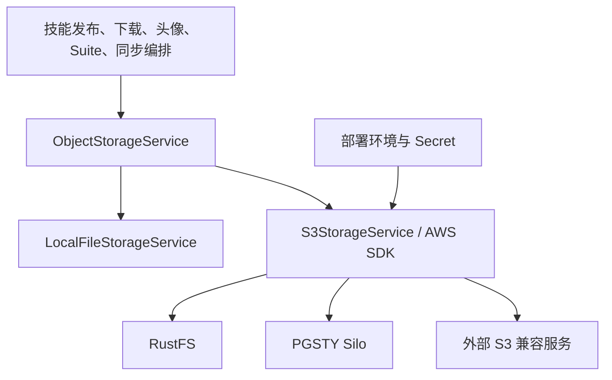
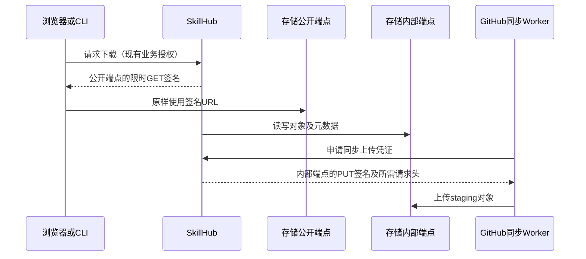

## Context

动机和范围见 [proposal.md](./proposal.md)。设计基线为 `6c739b838ed543dac9967e60b248fbacad4ad9f0`，源代码核对日期为 2026-10-21。本文件定义目标方案；实际实现与验收状态以 tasks.md 和对应交付记录为准。

### 已有能力与实际缺口

| 位置 | 已有事实 | 本次处理 |
|---|---|---|
| `server/skillhub-storage/.../ObjectStorageService.java` | 对象读写、删除、元数据、下载签名；上传签名与前缀统计为可选能力 | 保持接口边界，新增共享契约测试 |
| 同模块 `S3StorageService.java` | AWS SDK，支持 endpoint、publicEndpoint、路径寻址、预签名 | 验证协议差异，只有测试证明必要时才局部修复 |
| `compose.release.yml` | 传入 S3 参数，无本地对象存储服务 | 新增可选叠加文件，不改现有部署默认值 |
| `docker-compose.yml` | 开发环境 `minio` 服务实际使用 PGSTY Silo | 保留服务名和旧镜像别名兼容 |
| `.env.release.example` | 显式 local；Compose 缺省 provider 为 s3 | 新示例显式设置 provider，避免依赖不同层默认值 |
| `charts/skillhub/values.yaml` | `s3.enabled`、外部端点、`existingSecret` | 提供接入示例，不增加必装存储子 Chart |
| `GithubSyncUploadAppService` | local 流式上传、s3 预签名 PUT | 保留模式和上传凭证边界，验证 Worker 可达性 |

S3 当前客户端初始化不等于存储可用性验证。既有单元测试不能证明 RustFS 或 Silo 的真实兼容性。批量删除响应中的逐项错误需要补充失败响应测试，以判断是否需要修复成功判定；不能仅凭 HTTP 200 宣告全部成功。

## Goals / Non-Goals

**Goals:** 以统一 S3 协议保持业务代码稳定，交付可选存储运行方式、可重复的新部署接入验收及迁移风险参考。

**Non-Goals:** 不引入 `rustfs` / `silo` provider、业务模块专用 SDK、插件加载框架、多后端路由、双写、热切换、数据库迁移或后台配置页面。不将本次单机示例包装成高可用集群方案，不自动升级已有 Silo 部署。不提供自动迁移或宣称生产迁移支持，旧 MinIO/local 真实迁移及大规模生产迁移尚未验收。

## Decisions

### D1. 架构：沿用协议接口，供应商差异留在部署层



`skillhub-storage` 持有接口、实现、属性与协议测试；应用服务只编排业务调用。产品初始化命令和镜像参数留在交付文件及操作手册中。现有 domain 到 storage 的已知依赖偏差不在本次扩大或重构。

替代方案：每个品牌实现一个 adapter 会重复签名、重试与错误处理，无法提升本次扩展性；通用插件框架增加没有实际调用需求的机制。只有将来出现实际非 S3 协议需求时再评估新实现。

### D2. 技术配置：复用已有键，部署时确定后端

下表全部是已有配置键。此处是新本地存储示例的目标取值，不覆盖全局默认值。自建 S3 操作示例优先展示 Silo，RustFS 保留可选；这是基于本项目当前接入验收及既有部署方式的示例顺序，不是通用可靠性排名，不代表已验证 Silo 的长期生产可靠性。`.env.release.example` 保持 local，开发 Compose 保持原有 Silo，基础发布 Compose 的 provider 缺省为 s3 且不捆绑存储服务。本次没有长期稳定性、大规模负载或 HA 对比证据。

| 环境变量 | 示例或要求 |
|---|---|
| `SKILLHUB_STORAGE_PROVIDER` | `s3` |
| `SKILLHUB_STORAGE_S3_ENDPOINT` | `http://object-storage:9000`，后端和 Worker 可达 |
| `SKILLHUB_STORAGE_S3_PUBLIC_ENDPOINT` | 例如 `https://storage.example.com`，下载方可达；留空则使用内部端点 |
| `SKILLHUB_STORAGE_S3_BUCKET` | `skillhub`，先准备 |
| `SKILLHUB_STORAGE_S3_REGION` | 示例 `us-east-1`，与服务配置匹配 |
| `SKILLHUB_STORAGE_S3_FORCE_PATH_STYLE` | 本地产品示例明确 `true` |
| `SKILLHUB_STORAGE_S3_DISABLE_CHUNKED_ENCODING` | 按契约测试结果显式设置，不以品牌条件散落在业务代码中 |
| `SKILLHUB_STORAGE_S3_ACCESS_KEY` / `SKILLHUB_STORAGE_S3_SECRET_KEY` | 业务账号，由受保护 env / Secret 注入 |
| `SKILLHUB_STORAGE_S3_AUTO_CREATE_BUCKET` | 新示例 `false` |
| `SKILLHUB_STORAGE_S3_PRESIGN_EXPIRY` | 沿用现有 `PT10M` 默认值，验收另用短期签名 |

AWS 默认凭证链的既有接入能力保留，不强制所有外部 S3 使用静态密钥。静态凭证要求成对配置。密钥不进入 Git、镜像、系统配置表或诊断输出。

Helm 使用已有 `s3.*` 与 `existingSecret`，实施时核对模板实际 Secret 键名和优先级后提供可执行示例，不在此编造新的 values 字段。

### D3. 网络与签名：按实际访问方分流



当前 GET presigner 使用 publicEndpoint，未设置时回退 endpoint；PUT presigner 使用 endpoint。公开域名、证书和反向代理由部署者准备，不能在生成签名后替换 host、scheme 或路径。公网下载可达但 Worker 不可达不算验收通过。

启用同步时配置已有 `SKILLHUB_GITHUB_SYNC_ALLOWED_S3_HOSTS`，以及正数的 `SKILLHUB_GITHUB_SYNC_STAGING_CAPACITY_LIMIT_BYTES`；沿用现有上传 ticket、lease 和容量检查，不绕过安全主机校验。必要的专用存储域名代理转发应保持签名语义，不把未验证的子路径重写列为支持配置。

### D4. Compose 与 Helm 的交付方式

交付文件：

- `compose.storage.rustfs.yml`：RustFS 服务、健康检查、独立 `rustfs_data` 卷。
- `compose.storage.silo.yml`：Silo 服务、健康检查、独立 `silo_data` 卷。
- 产品配套 env 示例与初始化操作说明：由实施任务确定文档路径并链接到现有部署手册。

两个叠加文件各自提供 `object-storage` 服务，**只能选择一个**。由于 Compose 合并同名服务可能产生混合配置，不能依赖 Compose 自己报错：新增薄包装部署预检入口，检查输入文件列表，在执行 Compose 前拒绝同时选择二者，并将余下参数透传。手册采用该入口；直接调用 Compose 的高级用法需明确互斥条件。

部署操作与初始化步骤见 `docs/object-storage.md`；通过包装脚本保证单选：

```sh
# 先准备私有桶和业务身份，再使用一个选定的叠加文件
# 仓库根目录；操作会启动并修改相应项目的容器/卷
# .env.release 由部署者准备，存储初始化步骤另见手册
scripts/storage-compose.sh --storage silo --env-file .env.release --project-name skillhub -- up -d
```

RustFS 使用对应 env 示例并将参数 `--storage silo` 改为 `--storage rustfs`；外部 S3 使用 `--storage external`，仅加载基础 Compose。status、升级和 down 必须沿用相同 project、env 和文件组合，不删除数据卷作为更新步骤。

启动顺序：存储健康 → 操作者或显式一次性初始化准备桶/业务账号 → 业务凭证诊断通过 → 启动应用 → 业务冒烟。基础 Compose 的本地存储卷和权限初始化暂不清理，避免扩大改动。

初始化优先提供人工可执行的明确步骤，不默认启动持有 root 密钥的常驻容器；如封装一次性初始化，必须幂等、失败阻断且完成后退出。具体产品命令、环境变量、健康接口和 UID 以所选发行版官方资料与运行结果确认，不能照搬另一产品参数。

Helm 将存储作为独立服务管理。Chart 的安装、升级和卸载不承担对象存储生命周期，避免卸载应用误删数据。现有测试脚本中使用 Silo 不代表 Chart 默认捆绑它。

### D5. 请求体重放与临时文件

实际发布通过 `Files.newInputStream` 提供不可 reset 的流。AWS SDK 2.20.26 的签名/重试会重读请求体，直接 `RequestBody.fromInputStream` 在此路径下会消耗流并使后续发送不完整；真实应用和文件流契约已复现超时，内存流测试不能覆盖此缺陷。

复用适配层已有暂存 helper，将每次 PUT 的请求体暂存到私有临时文件，用 `RequestBody.fromFile` 提供可重放的源；不在内存缓存整个包。上传前校验实际字节数与声明大小，成功失败均释放暂存文件。暂存写入必须保留创建时的私有权限，不能通过替换文件重建为默认权限；POSIX 环境仅授予运行身份读写权限（0600）。读取发生 IOException 或运行时异常时，helper 必须清理尚未返回给调用方的文件；清理失败不得掩盖原始异常。接口与调用方保持不变，代价为每次 S3 PUT 增加一次临时磁盘写入，部署需计入并发上传的临时空间预算。

### D6. 镜像、诊断与兼容性证据

镜像必须固定经验证版本与 digest，记录支持的 CPU 架构、许可证、来源和制品扫描结果。镜像同步使用产品独立且不可变的目标标签；保留已有 `minio:latest` 兼容映射，不用 RustFS 接管这个别名。`scripts/mirror-runtime-images.sh` 遇到已有目标会跳过，若需要刷新仓库必须显式验证目标 digest，不能靠改清单完成。

不新增公开可写健康接口。新增显式调用的存储诊断脚本/测试入口，经配置绑定真实 `ObjectStorageService`，在随机专用前缀执行 put/get/head/list/delete 与签名验证，设置整体超时，使用 finally 清理；清理失败也返回非零并报告脱敏的残留键。只删除本次生成的确切对象，不按宽泛前缀清空桶。普通 liveness 不执行远程写入。

共享契约测试用同一应用构件，按后端注入配置。真实测试失败不能因凭证或 Docker 缺失被计为通过；默认单元测试可不启动存储，但被选为交付门禁的集成任务缺环境必须失败或明确阻断。负向权限和批量部分失败先用确定性模拟响应验证错误分支，再在实际产品可控权限条件下验收。满批真实删除遇短暂逐项失败时，适配层必须抛错；契约测试记录这条失败证据，最多进行 3 次调用方恢复，最后独立列举确认对象不存在。生产适配器不新增一套隐式重试策略，沿用现有业务补偿。

## Risks / Trade-offs

- [供应商声称 S3 兼容但有操作差异] → 只发布被测版本与契约范围，不能宣称任意版本全兼容。
- [签名可生成但目标不可达] → 从真实浏览器/CLI 和 Worker 网络分别调用，不只断言 URL 字符串。
- [最小权限不足或过宽] → 按实际对象、列举和批量删除操作配置桶权限；初始化权限不交给业务进程。
- [故障时静默回退导致数据分散] → 不增加 fallback，沿用明确存储异常与脱敏日志。
- [对象公开直读绕过业务权限] → 桶保持私有；检查匿名直读拒绝与签名有效期；临时签名持有者有效期内可读是现有行为。
- [单机存储失败导致不可用] → 明确持久卷、备份恢复和容量监控，不将本方案宣称为 HA。
- [更多配置增加维护成本] → 不改核心业务接口，使用共享测试与单一协议操作手册，产品特有内容限于部署附录。

## Migration Reference and Boundaries

以下保留迁移安全要求，作为操作参考，不构成已支持的生产迁移方案。已完成的证据仅为独立测试桶中 RustFS → Silo → RustFS 的小样本演练（正向 134 个对象、回退 135 个对象）；没有旧 MinIO/local 真实迁移或大规模生产迁移验收。生产实例需要另行设计和演练，不能用新部署接入通过或小样本结果替代。

1. 清点现有 backend、桶、对象键、元数据和加密方式；备份对象及部署配置，演练恢复。原始数据卷不能直接挂给 RustFS；Silo 即使声称格式兼容，也不默认做原地切换。
2. 准备独立目标桶和业务账号，在专用前缀跑契约探针；逻辑复制对象，保留 key、Content-Type 及必要元数据。跨加密后端通过授权逻辑读取再写入，不能拷贝内部加密文件。
3. 记录对象清单、大小及内容校验结果，不能把 ETag 一律当 MD5；迁移工具以实际能力选择，记录版本与命令，不预设某个工具已支持全部元数据。
4. 进入维护窗口，暂停发布、头像申请/处理、Suite 写入、GitHub 同步、过期清理等所有存储写入和删除；排空在途任务。对已签发 PUT 链接等待过期或以旧存储权限撤销写入，防止最终同步后仍有旧端点写入。
5. 在明确冻结点执行最终同步，协调新增、覆盖和删除差异；旧源只读保留。GET 旧签名仍可能在有效期内指向旧端点，应保留可读访问或明确短暂中断窗口。
6. 切换部署配置并重建受影响服务，验收元数据、实际下载、头像审核、Suite、同步上传/入库/清理。结果符合场景矩阵才恢复写入。
7. 恢复写入前可切回未变更旧源；恢复写入后回退必须再次停写，将新后端新增、覆盖及删除差异协调回旧源并校验，不能仅改 endpoint。保留期由部署方按备份政策确定，确认恢复能力后才单独授权清理旧源。

无需 SQL 迁移或 CHECK 约束。文件系统 local → S3 也需逻辑复制，不能只修改 provider。

## 验收矩阵与质量门禁

下面是验收要求；实际执行结果在 tasks.md 和交付验收记录中逐项关联，未执行项不能借文档校验声明通过。

| 需求 | 验收场景和独立断言 | 阶段 / 阻断条件 |
|---|---|---|
| S3-01 | 同一应用对 RustFS/Silo 运行共享套件；local、外部 S3 配置兼容 | 集成；任一新增产品失败不得声明支持 |
| S3-02 | 随机二进制与中文/空格键精确读回；元数据比对；缺失对象；单删/批删/部分失败；分页及上限完整标志 | 单元＋真实集成；字节或错误判定不一致阻断 |
| S3-03 | 实际请求 GET/PUT；必需头；公开/内部网络；过期/篡改拒绝 | 集成；只生成 URL 不算通过 |
| S3-04 | 错密钥、拒绝权限、断网超时；匿名私有对象拒绝；无本地 fallback；日志无凭证 | 负向集成；越权、静默成功或泄密阻断 |
| DEP-01 | 两个文件分别渲染与启动；双选预检拒绝；独立卷；外部 S3 无本地服务 | 配置＋真实部署；配置混合或卷复用阻断 |
| DEP-02 | 初始化幂等、root 不进入应用；Helm Secret 模板；Worker allowed-host 与容量预算 | 配置＋集成；权限越界或同步失败阻断 |
| DEP-03 | 固定 digest/架构与镜像扫描证据；诊断成功清理、失败退出；旧镜像别名回归 | 交付；缺不可变制品或存在未处理阻断漏洞不发布 |
| DEP-04 | 带覆盖/删除/在途 PUT 的小样本迁移与回退，校验逻辑对象差异 | 迁移演练；丢对象/复活已删除内容阻断 |
| 跨能力 | 发布 ZIP→审核→下载字节一致；头像私有待审→批准→移除；Suite 包；GitHub staging PUT→导入→清理 | E2E；只用 SDK 测试不能替代业务路径 |

需求门禁：本变更行为和范围明确；设计门禁：接口、网络、凭证、停写及回退边界一致；实现门禁：模块测试/配置回归通过；交付门禁：两种产品真实契约、关键业务链和迁移演练有证据。某项失败先修复并重跑受影响集合，不通过不得升级为“可发布”。保留支持矩阵，包含失败、未执行和限制，不只填写通过数量。

## Open Questions

以下项目不改变架构与行为契约，但进入交付前必须补齐证据：

- 已按官方 manifest 固定 RustFS 1.0.3、Silo RELEASE.2026-10-18T00-00-00Z（含 amd64/arm64），清单见 `docs/object-storage.md`。实际 amd64 镜像与初始化权限、扫描结果已核验，Silo 单条 legacy 模块告警的源码和行为裁定见用户手册；不把 manifest 核验扩大为 arm64 运行支持。
- 迁移参考已记录小样本演练；实际旧 MinIO/local 来源、数据规模、元数据、版本历史、锁及加密场景没有生产迁移证据，不列入本次接入支持范围。

## 参考与证据边界

- [Issue #937](https://github.com/iflytek/skillhub/issues/937)：问题来源；讨论不等于产品已验收。
- [MinIO 源仓库](https://github.com/minio/minio)：维护状态参考，具体迁移仍需部署方决定。
- [RustFS 官方 S3 兼容说明](https://docs.rustfs.com/en/reference/s3-compatibility)：厂商协议覆盖说明，不是 SkillHub 实测结果。
- [RustFS 官方发布](https://github.com/rustfs/rustfs/releases)：实施时选择并核验制品，不能使用可变 latest 作为验收基线。
- [PGSTY Silo 源仓库](https://github.com/pgsty/silo)：独立社区分支来源；格式兼容声明不替代备份恢复测试。

实现采用本次固定镜像及同一工作区应用构件验证，结果见任务状态与交付记录；不继承历史预览、其他应用或厂商测试的通过结论。
